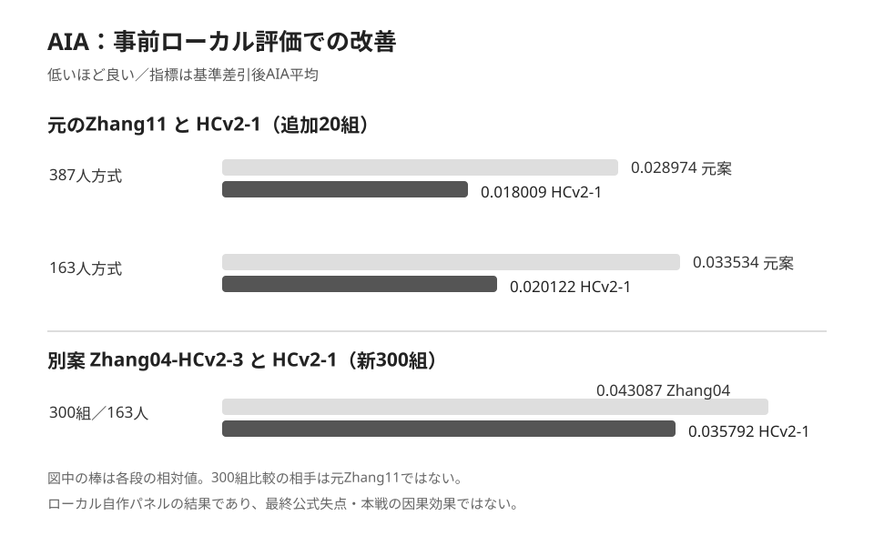
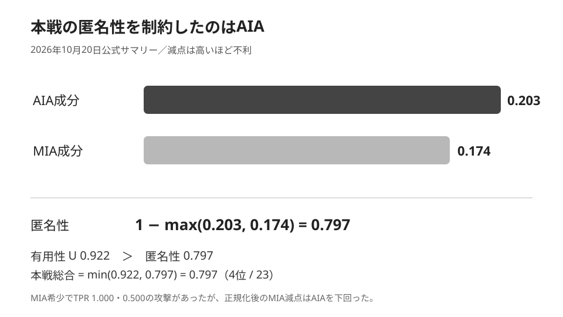

# PWS CUP 2026：AIA・MIA対策の効果と予想／実績の統合評価

**作成日：2026-10-23｜対象：ステテコは恥だが役に立つ（本戦 Team 28）**

## 0. 要旨

**判定：AIA対策候補のTG交換はローカルの平均的な攻撃に対して有効だった。一方、本戦の最終匿名化データには想定以上のAIA攻撃が成功した。MIAは全体TPRが低い一方、希少MIAで2チームに突破された。** **重要な留保：9月25日時点の記録ではTG交換案は第一候補で試験提出済みだが、最終採用指定は変更していない。最終サマリーにはCのハッシュがないため、HCv2-1が最終採用されたかを確定していない。** 本戦におけるTG交換の純粋な因果効果も測れない。

| 論点 | 事後判断 | 要点 |
|---|---|---|
| AIA：TG交換の追加効果 | **局所実験では有効／公式本戦への純増効果は未同定** | U維持、20組・300組で平均改善。本戦AIA減点は0.203 |
| AIA：合成加工全体 | **比較的強いが尾部に弱点** | 本戦匿名性4/23位。しかしR最大0.292、次点0.278 |
| MIA：全体 | **抑制できたが反実仮想比較は不可** | 被攻撃者22チームによるMIA全体TPRの最大は0.080 |
| MIA：希少 | **防御突破あり** | k等分の花嫁がTPR1.000、あれが0.500 |
| 希少6行・90%平滑化の上乗せ案 | **改善を確認できず、不採用** | Zhang11山登りへ足すと希少MIA最大0.041667→0.083333に悪化 |
| チームの攻撃側予測 | **4指標で一致** | 第8回希少MIA平均・MIA力・AIA力・攻撃力の事前予測＝公式実測 |

**公式最終成績**：最終総合0.771（5/23位）、最終攻撃力0.504（1/23位）。本戦総合0.797（4/23位）、本戦U=0.922、匿名性=0.797、攻撃力≈0.523。総合得点と攻撃力を混同しない。

## 1. 比較した主な加工候補と最終採用の確認範囲

出発点はZhang11の**合成データ生成**。公開背景A_bg・真のBの集団特性を使い、転帰・timeも含めた新規のレコードを生成する。Zhang11は通常群のCoxモデルで係数に加えWald量も考慮する。追加のHCv2-1は、公開判定で通常となるCの**316行目と1049行目のTG（中性脂肪）を1回交換**する。変更は2セルだけ。元Zhang11とHCv2-1の公式Uはどちらも正確に **0.9219987812309569** である。

**採用状態の区別**：9月25日の[検討記録](../../バトル結果/共有用_20260925_焼きなまし山登り記録/README.md)ではHCv2-1が第一候補で、2案とも試験提出済み。ただし同日時点のリーダーボード最終採用指定は未変更。後日の最終採用Cを同定できる原本は今回の資料では確認できない。従ってこの章の内容は「有力な対策候補とその検証」であり、「最終結果を生んだ加工の確定履歴」ではない。

TG単独の周辺分布は交換前後で同じだが、他の属性とTGの同時関係が変わり、近傍照合やtime推定を使うAIAの結果を変えうる。この操作を「希少MIAの対策」とは呼ばない。交換した2行はいずれも公開外れ値判定では通常だった。

**[実際の加工・元案・再現コード](../../Zhang11-HCv2-1/README.md)**

## 2. AIA対策は効いたか

### 2.1 比較対象を明示したローカル証拠

| 比較 | 指標（低いほど良い） | 比較前 | HCv2-1 | 結果 |
|---|---|---:|---:|---|
| 元Zhang11→HCv2-1、追加20組／387人方式 | 基準差引後AIA平均 | 0.028974 | **0.018009** | 37.8%減 |
| 元Zhang11→HCv2-1、追加20組／163人方式 | 基準差引後AIA平均 | 0.033534 | **0.020122** | 40.0%減 |
| 元Zhang11→HCv2-1、追加20組／163人方式 | 補正前AIA平均 | 0.153092 | **0.139680** | 8.8%減 |
| 元Zhang11→HCv2-1、追加20組／全体MIA | MIA平均 | 0.148077 | 0.148077 | 改善なし |
| 別案Zhang04-HCv2-3→HCv2-1、独立300組／163人方式 | 基準差引後AIA平均 | 0.043087 | **0.035792** | 約17.0%減 |

300組の最終行は**元Zhang11との比較ではなくZhang04との別案比較**。固定パネルの対応差（HCv2-1−Zhang04）は−0.007295、95%信頼区間−0.011093〜−0.003496、両側p=0.000190。HCv2-1が良い125組、同点83組、Zhang04が良い92組。模擬実験の95%信頼区間を本戦性能の保証と読まない。補正前AIA最大はむしろZhang04の0.447368がHCv2-1の0.461538より低い。

この意味で、**追加TG交換には、少なくとも採用したローカル攻撃群に対する平均改善の根拠がある**。反面、最大被害を防ぐという意味では一律に優れていない。

出典：[HCv2-1の評価](../../Zhang11-HCv2-1/README.md)、[新300組の実験](../../バトル結果/共有用_20260925_焼きなまし山登り記録/実験記録/12_2案300組_AIA基準補正比較/README.md)。

### 2.2 本戦は事前の「低い失点」という期待を上回る攻撃が来た

10月20日配布の公式最終サマリーによると、Team 28の本戦AIA最大は**コログの森団のR=0.292**。次点は**神ぼ大のR=0.278**。自チームの基準φ≈0.089を引き、AIA減点は**0.203**。

**候補HCv2-1に対する、本戦結果とは同条件でない参考比較として**、本戦データ由来の別の300組評価では、HCv2-1の補正前AIAの95パーセンタイルは**0.290650**、固定φ=0.089047との差引指標の95パーセンタイルは**0.201603**だった。実測R=0.292／減点0.203は概ねその上位5%付近の厳しい結果に位置する。ただし300組は自作パネル・12攻撃で、公式本戦と同一の攻撃標的・対照・相手方アルゴリズムではない。**「5%の確率で発生した」とは解釈しない。**

さらに9月28日の**実配布標的を固定して未知の対照を100通り補完**したローカル実験では、φ差引AIA失点の予想平均が元Zhang11 **0.007912**、HCv2-1 **0.006449**、HCv2-1の100通り中の最大も**0.100142**だった。本戦実測0.203はそれを大幅に上回った。この模擬実験は追加交換が平均で改善するかを比較する目的には利用できたが、本戦最悪攻撃者の絶対失点を予測する目的には楽観的だった。

出典：[9/28の課題固定100補完](../../Zhang11-HCv2-1/検証結果/20260928_配布課題固定_対照100通り補完/README.md)、[10/20最終結果](../../../攻撃フェーズ/Tashiro/最終詳細結果_20261020/README.md)。

**評価**：候補HCv2-1のローカルAIA対策は「無効」ではない。平均改善とU維持の事前根拠はある。最終CにHCv2-1が採用されていたかを確定していない点も踏まえる必要がある。競技は**最強の攻撃者による最大R**で匿名性が決まるため、平均の改善を本戦の安全性と同一視した部分が弱点だった。

## 3. MIA対策は効いたか

### 3.1 MIA全体：低いTPRは確認できた

最終サマリーでは、Team 28へ仕掛けた22攻撃者の**MIA全体TPRの最大は0.080**。この意味で、全体MIAだけを見ると攻撃は概して低く抑えられた。ただし、元のZhang11とHCv2-1の20組ローカル比較では全体MIA平均はともに**0.148077**、最大もともに**0.307692**であり、**TG交換がMIAを改善した証拠はない**。ローカルMIA0.148077と公式最大0.080は標的・対照・攻撃方法が違うのでその大小を効果量に使わない。

「合成生成によって原レコードを直接残しにくくした設計」はMIA耐性の候補説明になるが、今回の公式最終値単独から、元データをそのまま出した場合や他加工方式に比べた**因果効果・改善率**は出せない。

### 3.2 MIA希少：一部攻撃者に突破された

| 本戦攻撃者（ID） | MIA全体TPR | MIA希少TPR | 評価 |
|---|---:|---:|---|
| k等分の花嫁（6） | 0.077 | **1.000** | 希少MIAで満点 |
| あれ / are（16） | 0.000 | **0.500** | 希少MIAで高い成功 |
| bot035（17） | 0.038 | 0.000 | 希少成功は確認されず |
| アウトサイダー（10） | 0.000 | 0.000 | 同上 |
| Shiroto（25） | 0.000 | 0.000 | 同上 |
| HiddenMetrics（11） | 0.000 | 0.000 | 同上 |

希少MIA欄が有効な6チームのうち、2チームが明確に成功した。他16チームの「—」は希少会員対象なしであり「成功0」とは異なる。

公式の被攻撃MIAは各攻撃者の**全体と希少の最大値**を用いる。このため、上記k等分の花嫁1.000とあれ0.500だけで、被攻撃のt_j総和の約**86.3%**を占めた。ただし補正・正規化後のMIA成分は**0.174**に留まり、本戦Anonの制約にはならなかった。

出典：[最終被攻撃表と採点式](../../../攻撃フェーズ/Tashiro/最終詳細結果_20261020/README.md)。

### 3.3 検討した希少6行平滑化は採用していない

希少MIAを直接抑える別案として、**公開希少Cから6行を選び、連続7属性を背景の近傍希少行へ90%移動**する追加加工を比較した。固定条件のローカル希少MIA診断では、Zhang11山登り単独の最大**0.041667**に対し、両方を加えた案は**0.083333**に悪化し、AIA側も一部悪化した。異なる出所の対照によって数値が激しく動き、一般化は保証できなかったため**上乗せ採用を見送った**。この未採用案を「本戦MIA対策が失敗した実証」として混同してはいけない。

出典：[希少対策×山登り12案の比較](../../バトル結果/共有用_20260925_焼きなまし山登り記録/実験記録/10_希少対策との組合せ/説明.md)。

## 4. 何が予想どおりで、何が違ったか

| 事前の期待・判断 | 事後結果 | 照合 |
|---|---|---|
| TGを2セル交換すればUを保てる | 公式Uは元案・交換案とも0.9219987812309569 | **一致** |
| TG交換はAIAの平均を下げる | 20組・新300組・課題固定100補完で平均改善 | **ローカル評価では一致** |
| TG交換はMIAにも効くかもしれない | 全体MIA20組の平均・最大は変わらず | **改善根拠なし** |
| 実配布標的を用いた9/28のAIA失点予想は低い | 予想平均0.006449に対し本戦0.203 | **大幅に不一致** |
| AIAの悪いケースがまれにありうる | 300組のφ差引p95≈0.201603に本戦0.203が近い | **尾部リスクの方向は一致** |
| 全体MIAは大きく突破されない | 本戦被攻撃の全体TPR最大0.080 | **定性的には一致** |
| 希少MIAも十分に保護できるか | 2チームで希少TPR1.000／0.500 | **期待に反する突破** |
| 希少6行平滑化を重ねれば改善する | ローカル診断では非改善・一部悪化 | **仮説不支持、提出前に見送り** |
| 第8回の自チーム攻撃の4指標の予測 | 4指標とも未丸め公式値に一致 | **完全一致** |

### 第8回「攻撃側」の予測と実測：全て一致

| 項目 | 提出前の確定予測 | 第8回公式実測 |
|---|---:|---:|
| 希少MIA平均 | 1.000000000 | 1.000000000 |
| MIA力 | 0.32545454545454544 | 0.32545454545454544 |
| 補正後AIA力 | 0.1974545628388099 | 0.1974545628388099 |
| 攻撃力合計 | 0.5229091082933554 | 0.5229091082933554 |

自チームが**攻撃を仕掛けて得た数値**であり、Team28の**防御結果（MIA減点0.174、AIA減点0.203）**とは指標の向き・集計方法が違う。10月20日発表の最終攻撃力**0.504**は予備戦0.330を10%、本戦0.523を90%で混ぜたもの。第8回の攻撃力0.522909…との不一致ではない。

出典：[第8回実結果](../../../攻撃フェーズ/Tashiro/第8回実結果_20261011/README.md)、[最終集計](../../../攻撃フェーズ/Tashiro/最終詳細結果_20261020/README.md)。

## 5. 得点構造からみた総合評価

Team28の本戦では、**AIA成分0.203 ＞ MIA成分0.174**。

- **Anon = 1 − max(0.203, 0.174) = 0.797**
- **U = 0.922**
- **本戦総合 = min(0.922, 0.797) = 0.797**

匿名性は4/23位で中央値0.603を上回った。したがって防御全体としては健闘している。ただし、有用性Uだけを上げても現在の総合は改善しない。まずAIA最大R=0.292だけでなく**次点R=0.278**も含めて抑える必要がある。最大1チームだけを十分下げても、次点が残ればAIA減点は約0.189でAnonは最大約0.811にとどまる（他を固定した算術上限）。

すべてのAIAをMIA減点0.174以下まで抑えられた場合、MIAを固定すればAnonの上限は約**0.826**。これは加工の変更によって達成できるという予測ではない。

U側では、**U_rare=0.922（17/23位）**、希少プロファイルの採点**0.922（21/23位）**がボトルネック。一般有用性0.937、特定タスク0.960、妥当性1.000である。匿名性の改善と同時にUをさらに下げないか確認することが必要。

## 6. 最終判断と再発防止の実験設計

**結論は「平均改善に成功した追加AIA対策候補」「本戦最終CではAIAの最大攻撃がボトルネック」「MIA全体は低水準、希少MIAは部分的に破綻」の3点。** 最終CがHCv2-1であること自体の独立確認と、追加TG交換の本戦因果効果は得られていない。最終成績をこの2セルへ帰属させない。

次回の加工比較では、平均だけでなく**最大・p95・複数攻撃者の上位順位・希少MIA**を事前固定の主指標として扱う。公開の同じ有限標的にパネルを引き直すだけでは未知攻撃者への外挿が弱い。パネルの出所・補完方法・攻撃器をずらした独立性の高い評価を追加する。最終提出版と未採用候補の差分を保持し、非採用案の成績を実提出の成績へ紛れ込ませない。

### 根拠の階層

1. **公式最終結果（2026-10-20）**：[Team28最終詳細結果](../../../攻撃フェーズ/Tashiro/最終詳細結果_20261020/README.md)／[転記・検証JSON](../../../攻撃フェーズ/Tashiro/最終詳細結果_20261020/検証と集計.json)（623検査・0失敗）。
2. **公式第8回攻撃結果（2026-10-11）**：[提出ID975222の再現と値](../../../攻撃フェーズ/Tashiro/第8回実結果_20261011/README.md)。
3. **事前ローカル比較**：[Zhang11-HCv2-1](../../Zhang11-HCv2-1/README.md)、[300組](../../バトル結果/共有用_20260925_焼きなまし山登り記録/実験記録/12_2案300組_AIA基準補正比較/README.md)、[100補完](../../Zhang11-HCv2-1/検証結果/20260928_配布課題固定_対照100通り補完/README.md)、[希少平滑化比較](../../バトル結果/共有用_20260925_焼きなまし山登り記録/実験記録/10_希少対策との組合せ/説明.md)。
4. **再集計用表**：[数値対照](集計/01_数値対照.csv)／[予想と実績](集計/02_予想と実績.csv)。公式値とローカル予測値を同一行で無批判に引き算しない。

