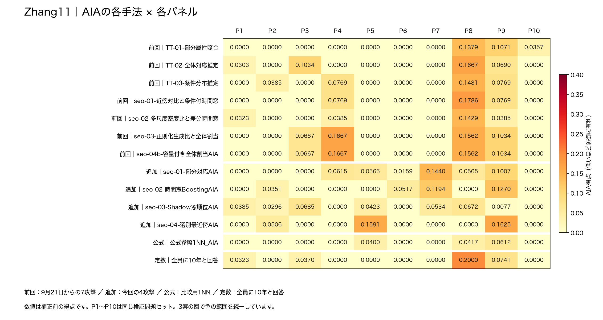
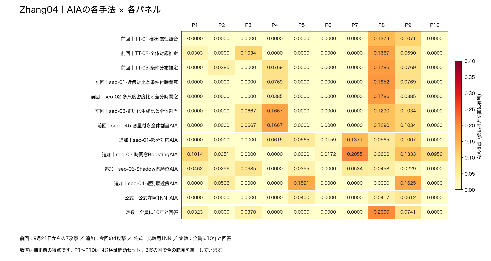
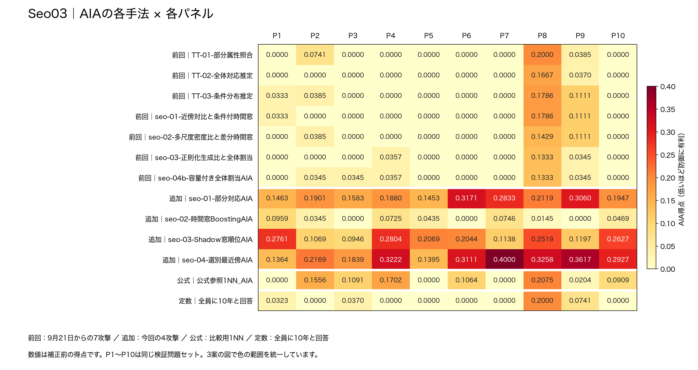

# Zhang11・Zhang04・Seo03：AIAの詳細比較

- [属性交換3候補を加えた7案の比較はこちら](../7案_共通5パネル比較/README.md)。共通5パネルでの別条件の比較です。このページの10パネル結果と数値を混ぜないでください。

- **対象は加工方法3案です。** Seo03は加工案 `seo-03-順位混合Wald調整` を指します。攻撃案のseo-03とは別です。
- 9月23日の結果から、**12攻撃×10パネル×3加工案＝360件**を抜き出しました。
- パネルは検証用の問題セットです。P1〜P10は、前回と同じ番号です。
- **AIA得点は低いほど防御に有利**です。0も実測値で、未実施を意味しません。
- 定数回答は、**加工済みデータCを見ず、全員に「10年」と答える方法**です。3案で同じ値になります。
- 根拠：保存済み結果の再集計と、的中人数からの再計算。【模擬実験・ローカル集計】

## 結論

- **12攻撃の最大だけを見ると、Zhang11が最も低い**結果です。
- **定数も含めると、最大値はZhang11＝0.2000、Zhang04＝0.2055、Seo03＝0.4000**です。Zhang11と04の差は約0.0055に縮みます。
- **Seo03は追加した3攻撃に弱い傾向が一貫しています。** 部分対応・Shadow窓順位・選別最近傍は、すべてのパネルで定数を上回りました。
- Zhang11と04の各パネルの攻撃最大は、10パネル中9つで同じパネルの定数を上回ります。「定数の全パネル最大が0.2だから、0.2未満はすべて無意味」とは判断できません。

## まず見る集計：各パネルで一番強かった攻撃

- 各パネルで12攻撃の最大を取り、その**10個の値**の最小・中央値・平均・最大を計算しました。
- 「定数も含めた最大」は、定数を13番目の方法として加えた場合です。

| 加工案 | 最小 | 中央値 | 平均 | 最大 | 定数も含めた最大 |
| --- | --- | --- | --- | --- | --- |
| Zhang11 | 0.0357 | 0.1237 | 0.1091 | 0.1786 | 0.2000 |
| Zhang04 | 0.0172 | 0.1313 | 0.1247 | 0.2055 | 0.2055 |
| Seo03 | 0.1839 | 0.3049 | 0.2903 | 0.4000 | 0.4000 |

- 定数10年だけの10パネル集計：**最小0.0000／中央値0.0000／平均0.0343／最大0.2000**。
- 同じパネルで12攻撃の最大が定数を超えた数：Zhang11＝9/10、Zhang04＝9/10、Seo03＝10/10。

## パネルごとの「12攻撃の最大」と定数

| パネル | 定数10年 | Zhang11 | Zhang04 | Seo03 |
| --- | --- | --- | --- | --- |
| P1 | 0.0323 | 0.0385 | 0.1014 | 0.2761 |
| P2 | 0.0000 | 0.0506 | 0.0506 | 0.2169 |
| P3 | 0.0370 | 0.1034 | 0.1034 | 0.1839 |
| P4 | 0.0000 | 0.1667 | 0.1667 | 0.3222 |
| P5 | 0.0000 | 0.1591 | 0.1591 | 0.2069 |
| P6 | 0.0000 | 0.0517 | 0.0172 | 0.3171 |
| P7 | 0.0000 | 0.1440 | 0.2055 | 0.4000 |
| P8 | 0.2000 | 0.1786 | 0.1852 | 0.3258 |
| P9 | 0.0741 | 0.1625 | 0.1625 | 0.3617 |
| P10 | 0.0000 | 0.0357 | 0.0952 | 0.2927 |

- **P8は定数が0.2000で、Zhang11の0.1786、Zhang04の0.1852より高い**値でした。
- P8の定数回答は、標的139/163人・対照133/163人に的中。人数差だけで得点がつきます。
- 得点は `max(0, (標的の的中率 − 対照の的中率) / (1 − 対照の的中率))`。単純な正解率ではありません。
- このため、**定数との差がプラスでも、その値を情報漏洩量と断定することはできません**。

## 各手法×各パネルの結果

- 各図の1行が攻撃手法、1列がパネルです。下段は定数回答です。
- 図の色の範囲は3案とも0〜0.4で統一しています。赤いほど攻撃側に有利です。
- 「前回」は9月21日からの7攻撃、「追加」は今回加えた4攻撃、「公式」は比較用1NNです。
- 手法ごとの表は、**その手法の10パネル**の統計です。「定数超え」は同じパネルで定数より高かった回数です。
- 正確な全数値と定数との差は[Excel](3案_AIA詳細比較.xlsx)に収録しています。

### Zhang11

| 区分 | 攻撃手法 | 最小 | 中央値 | 平均 | 最大 | 最大のパネル | 定数超え |
| --- | --- | --- | --- | --- | --- | --- | --- |
| 前回 | TT-01-部分属性照合 | 0.0000 | 0.0000 | 0.0281 | 0.1379 | P8 | 2/10 |
| 前回 | TT-02-全体対応推定 | 0.0000 | 0.0000 | 0.0369 | 0.1667 | P8 | 1/10 |
| 前回 | TT-03-条件分布推定 | 0.0000 | 0.0000 | 0.0340 | 0.1481 | P8 | 3/10 |
| 前回 | seo-01-近傍対比と条件付時間窓 | 0.0000 | 0.0000 | 0.0332 | 0.1786 | P8 | 2/10 |
| 前回 | seo-02-多尺度密度比と差分時間窓 | 0.0000 | 0.0000 | 0.0252 | 0.1429 | P8 | 1/10 |
| 前回 | seo-03-正則化生成比と全体割当 | 0.0000 | 0.0000 | 0.0493 | 0.1667 | P4 | 3/10 |
| 前回 | seo-04b-容量付き全体割当AIA | 0.0000 | 0.0000 | 0.0493 | 0.1667 | P4 | 3/10 |
| 今回追加 | seo-01-部分対応AIA | 0.0000 | 0.0362 | 0.0435 | 0.1440 | P7 | 5/10 |
| 今回追加 | seo-02-時間窓BoostingAIA | 0.0000 | 0.0000 | 0.0333 | 0.1270 | P9 | 4/10 |
| 今回追加 | seo-03-Shadow窓順位AIA | 0.0000 | 0.0340 | 0.0307 | 0.0685 | P3 | 5/10 |
| 今回追加 | seo-04-選別最近傍AIA | 0.0000 | 0.0000 | 0.0372 | 0.1625 | P9 | 3/10 |
| 公式比較用 | 公式参照1NN_AIA | 0.0000 | 0.0000 | 0.0143 | 0.0612 | P9 | 1/10 |

### Zhang04

| 区分 | 攻撃手法 | 最小 | 中央値 | 平均 | 最大 | 最大のパネル | 定数超え |
| --- | --- | --- | --- | --- | --- | --- | --- |
| 前回 | TT-01-部分属性照合 | 0.0000 | 0.0000 | 0.0245 | 0.1379 | P8 | 1/10 |
| 前回 | TT-02-全体対応推定 | 0.0000 | 0.0000 | 0.0369 | 0.1667 | P8 | 1/10 |
| 前回 | TT-03-条件分布推定 | 0.0000 | 0.0000 | 0.0371 | 0.1786 | P8 | 3/10 |
| 前回 | seo-01-近傍対比と条件付時間窓 | 0.0000 | 0.0000 | 0.0339 | 0.1852 | P8 | 2/10 |
| 前回 | seo-02-多尺度密度比と差分時間窓 | 0.0000 | 0.0000 | 0.0255 | 0.1786 | P8 | 1/10 |
| 前回 | seo-03-正則化生成比と全体割当 | 0.0000 | 0.0000 | 0.0466 | 0.1667 | P4 | 3/10 |
| 前回 | seo-04b-容量付き全体割当AIA | 0.0000 | 0.0000 | 0.0466 | 0.1667 | P4 | 3/10 |
| 今回追加 | seo-01-部分対応AIA | 0.0000 | 0.0362 | 0.0428 | 0.1371 | P7 | 5/10 |
| 今回追加 | seo-02-時間窓BoostingAIA | 0.0000 | 0.0478 | 0.0648 | 0.2055 | P7 | 6/10 |
| 今回追加 | seo-03-Shadow窓順位AIA | 0.0000 | 0.0325 | 0.0302 | 0.0685 | P3 | 5/10 |
| 今回追加 | seo-04-選別最近傍AIA | 0.0000 | 0.0000 | 0.0372 | 0.1625 | P9 | 3/10 |
| 公式比較用 | 公式参照1NN_AIA | 0.0000 | 0.0000 | 0.0143 | 0.0612 | P9 | 1/10 |

### Seo03

| 区分 | 攻撃手法 | 最小 | 中央値 | 平均 | 最大 | 最大のパネル | 定数超え |
| --- | --- | --- | --- | --- | --- | --- | --- |
| 前回 | TT-01-部分属性照合 | 0.0000 | 0.0000 | 0.0313 | 0.2000 | P8 | 1/10 |
| 前回 | TT-02-全体対応推定 | 0.0000 | 0.0000 | 0.0204 | 0.1667 | P8 | 0/10 |
| 前回 | TT-03-条件分布推定 | 0.0000 | 0.0000 | 0.0361 | 0.1786 | P8 | 3/10 |
| 前回 | seo-01-近傍対比と条件付時間窓 | 0.0000 | 0.0000 | 0.0323 | 0.1786 | P8 | 2/10 |
| 前回 | seo-02-多尺度密度比と差分時間窓 | 0.0000 | 0.0000 | 0.0292 | 0.1429 | P8 | 2/10 |
| 前回 | seo-03-正則化生成比と全体割当 | 0.0000 | 0.0000 | 0.0204 | 0.1333 | P8 | 1/10 |
| 前回 | seo-04b-容量付き全体割当AIA | 0.0000 | 0.0172 | 0.0272 | 0.1333 | P8 | 2/10 |
| 今回追加 | seo-01-部分対応AIA | 0.1453 | 0.1924 | 0.2141 | 0.3171 | P6 | 10/10 |
| 今回追加 | seo-02-時間窓BoostingAIA | 0.0000 | 0.0390 | 0.0382 | 0.0959 | P1 | 6/10 |
| 今回追加 | seo-03-Shadow窓順位AIA | 0.0946 | 0.2056 | 0.1917 | 0.2804 | P4 | 10/10 |
| 今回追加 | seo-04-選別最近傍AIA | 0.1364 | 0.3019 | 0.2690 | 0.4000 | P7 | 10/10 |
| 公式比較用 | 公式参照1NN_AIA | 0.0000 | 0.0986 | 0.0860 | 0.2075 | P8 | 6/10 |

## 補足：12攻撃×10パネルの全120件をまとめた統計

| 加工案 | 比較数 | 最小 | 中央値 | 平均 | 最大 | 定数超え／同じ／未満 |
| --- | --- | --- | --- | --- | --- | --- |
| Zhang11 | 120 | 0.0000 | 0.0000 | 0.0346 | 0.1786 | 33／53／34 |
| Zhang04 | 120 | 0.0000 | 0.0000 | 0.0367 | 0.2055 | 34／52／34 |
| Seo03 | 120 | 0.0000 | 0.0345 | 0.0830 | 0.4000 | 53／40／27 |

- この表は弱い攻撃も含めた120件の分布です。上の「パネルごとの最強攻撃10値」とは集計対象が違います。
- Zhang11・04の中央値が0でも、「すべての攻撃に安全」という意味ではありません。
- 定数との大小は小数点以下の丸め前に比較。差が1兆分の1以下は同じとしています。

## 比較から分かること

- **Zhang11の最大**：P8の「前回：seo-01-近傍対比と条件付時間窓」、0.1786。ただし同じP8の定数は0.2000。
- **Zhang04の最大**：P7の「追加：seo-02-時間窓BoostingAIA」、0.2055。同じP7の定数は0。
- **Seo03の最大**：P7の「追加：seo-04-選別最近傍AIA」、0.4000。同じP7の定数は0。
- **Seo03は単発の悪い結果だけではありません。** 追加の部分対応・Shadow窓順位・選別最近傍は、各10パネルすべてで定数超え。手法ごとの中央値は0.1924・0.2056・0.3019でした。
- **Zhang11と04の優劣は、最大値だけなら定数を含めるかで差の大きさが変わります。** パネル別・攻撃別も合わせて判断してください。

## 比較の範囲

- 同条件の10パネルだけを使用。保存済みC4案の5パネルやMIAと同時に行った補足AIAは混ぜていません。
- 定数は前回と同じ10年に固定しました。正解を見て定数を最適化した結果ではありません。
- 得点は補正前のR_allです。チームのφ＝0.089047は適用していません。
- 問題セットには同じ人物が重複します。独立した10回の実験ではなく、公式の匿名性得点や有意差を示すものでもありません。
- 定数込みの最大は今回の比較用集計です。公式の匿名性計算を再現した値ではありません。

## ファイル

- [Excel](3案_AIA詳細比較.xlsx)：まとめ、3案の全パネル表、定数との差、的中人数、定数の内訳。
- [手法別統計と定数比較](手法別統計と定数比較.csv)：最小・中央値・平均・最大と、定数との差の統計。
- [パネル別比較](パネル別比較.csv)：各パネルの最小・中央値・平均・最大と、最大を出した攻撃名。
- [360件の詳細](360件の詳細.csv)：元の的中人数と得点。個人別の情報は含みません。
- [定数の内訳](定数10年_パネル別.csv)：全員10年回答の的中人数と得点。
- 元データ：[9月23日のAIA全比較](../summary/AIA全2085比較.csv)・[全員10年回答](../summary/C非依存_全員10年.csv)。
