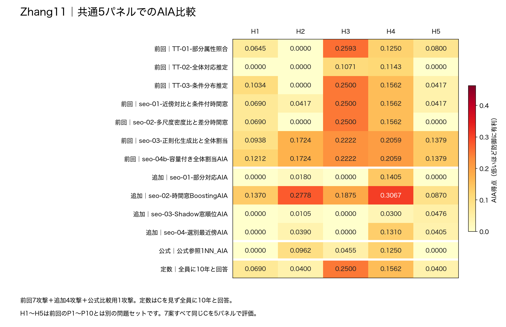
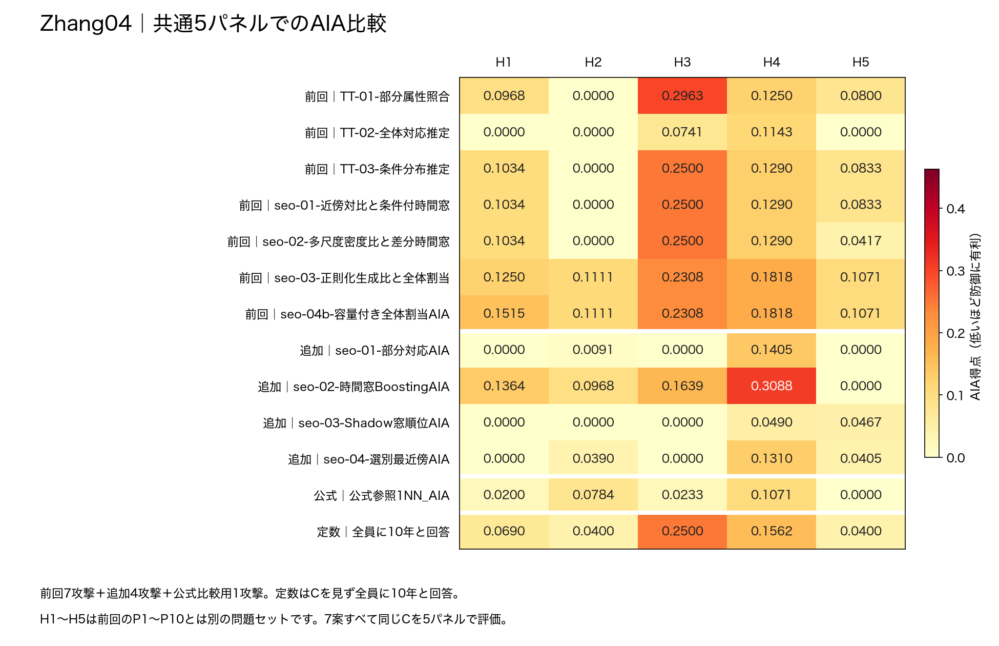
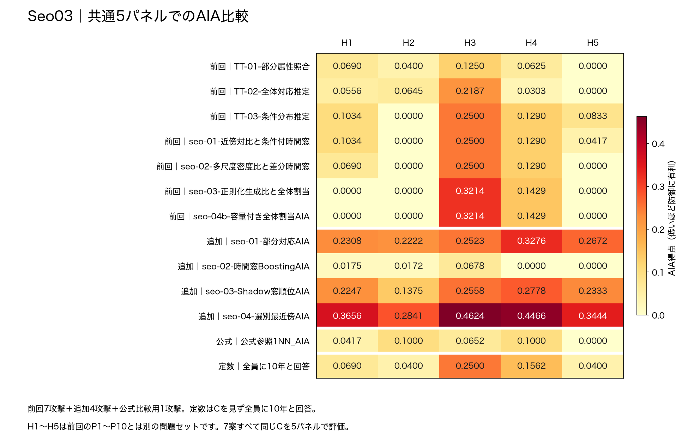
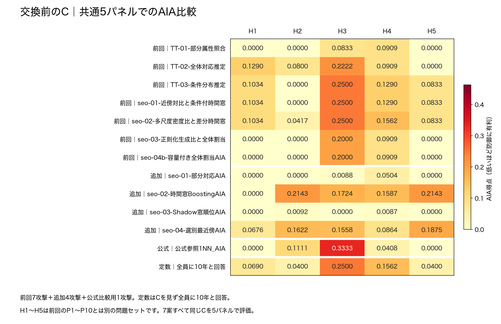
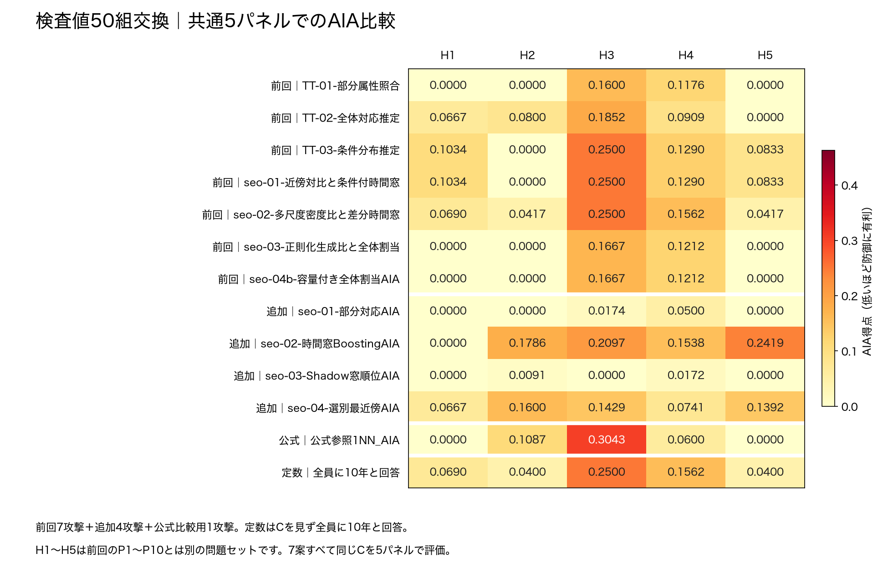
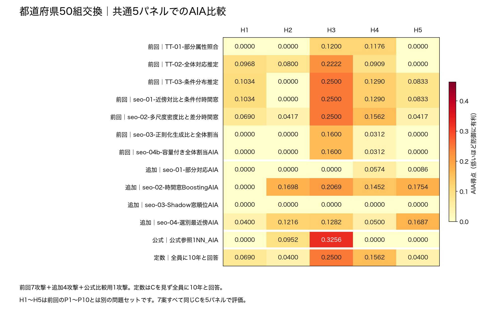
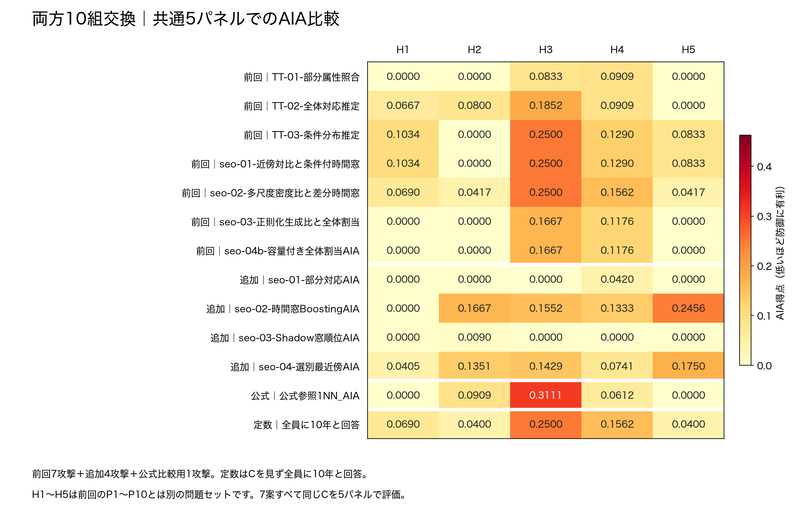

# 属性交換3候補を加えた7案の比較

- 指定された[GitHubの3候補](https://github.com/smsaku00/pwscup2026-sutehaji/tree/cd19c46191efeee56a3fd7616074a1b1e8e9e893/加工フェーズ/加工案/TT_20260923_Z09属性交換3候補_v1)を追加しました。
- **Zhang11・Zhang04・Seo03・交換前のC・交換後3候補の計7つ**を、同じ5パネル・12攻撃で比較しています。
- 追加180件＋既存240件＝**420件**。定数回答「全員10年」も同じパネルで比較しました。
- AIA得点は**低いほど防御に有利**、有用性Uは**高いほどよい**値です。【模擬実験・ローカル自己採点】

## 要点

- **最大得点が最も低いのは「検査値50組交換」**：0.3043、有用性Uは0.9375。
- Zhang11の最大0.3067との差は約0.0023です。この差だけで優位性を断定しません。
- **パネル最大値の中央値が最も低いのはZhang04**：0.1515。今回のZhang11は0.2593でした。
- 指定された3候補は交換前のCと同じUを保ち、最大得点はいずれも交換前の0.3333より下がりました。
- 7案とも、定数を含めても全パネルを通した最大値は変わりません。

## 比較するデータの意味

| 表での名前 | 何を比較したか |
| --- | --- |
| Zhang11・Zhang04・Seo03 | 検証対象を除いた共通の背景3,347人で、各方法の標準設定から作った保存済みC |
| 交換前のC | Zhang04で作った特定のC（旧名Z09、seed＝2026092209） |
| 検査値50組交換 | GitHubの `C_labs_n50_r3.csv` そのもの |
| 都道府県50組交換 | GitHubの `C_prefecture_n50_r1.csv` そのもの |
| 両方10組交換 | GitHubの `C_combined_n10_r3.csv` そのもの。都道府県・検査値を各10組交換 |

- **共有3候補のCSVは作り直していません。** GitHubとバイト単位で一致しています。
- 「交換前のC」もZhang04製ですが、上段の「Zhang04」とは乱数設定が異なる別のファイルです。
- **前回の10パネル比較とは条件が異なります。** 今回のH1〜H5は、前回のP1〜P10とは別の問題セットです。
- Zhang11・04のUが前回の0.9220と違うのは、生成に使った背景が変わったためです。今回の表は、**攻撃したCそのもののU**を載せています。

## 全体比較

- 各パネルで12攻撃の最大を取り、その**5個の値**の最小・中央値・平均・最大を計算しました。
- 「定数込み最大」は、定数10年を13番目の方法として加えた場合です。

| 評価したC | U ↑ | 最小 | 中央値 | 平均 | 最大 | 定数込み最大 |
| --- | --- | --- | --- | --- | --- | --- |
| Zhang11 | 0.9154 | 0.1370 | 0.2593 | 0.2237 | 0.3067 | 0.3067 |
| Zhang04 | 0.9154 | 0.1071 | 0.1515 | 0.1950 | 0.3088 | 0.3088 |
| Seo03 | 0.9245 | 0.2841 | 0.3656 | 0.3806 | 0.4624 | 0.4624 |
| 交換前のC | 0.9375 | 0.1290 | 0.2143 | 0.2099 | 0.3333 | 0.3333 |
| 検査値50組交換 | 0.9375 | 0.1034 | 0.1786 | 0.1969 | 0.3043 | 0.3043 |
| 都道府県50組交換 | 0.9375 | 0.1034 | 0.1698 | 0.1861 | 0.3256 | 0.3256 |
| 両方10組交換 | 0.9375 | 0.1034 | 0.1667 | 0.1966 | 0.3111 | 0.3111 |

- 定数10年だけの5パネル集計：最小0.0400／中央値0.0690／平均0.1110／最大0.2500。
- 追加3候補では、最大値が最も低いのは**検査値50組交換**、中央値が最も低いのは**両方10組交換**です。
- 最大値と中央値で順位が変わるため、どちらの指標かを明示して判断してください。

## パネルごとの12攻撃最大と定数

| パネル | 定数10年 | Zhang11 | Zhang04 | Seo03 | 交換前のC | 検査値50組交換 | 都道府県50組交換 | 両方10組交換 |
| --- | --- | --- | --- | --- | --- | --- | --- | --- |
| H1 | 0.0690 | 0.1370 | 0.1515 | 0.3656 | 0.1290 | 0.1034 | 0.1034 | 0.1034 |
| H2 | 0.0400 | 0.2778 | 0.1111 | 0.2841 | 0.2143 | 0.1786 | 0.1698 | 0.1667 |
| H3 | 0.2500 | 0.2593 | 0.2963 | 0.4624 | 0.3333 | 0.3043 | 0.3256 | 0.3111 |
| H4 | 0.1562 | 0.3067 | 0.3088 | 0.4466 | 0.1587 | 0.1562 | 0.1562 | 0.1562 |
| H5 | 0.0400 | 0.1379 | 0.1071 | 0.3444 | 0.2143 | 0.2419 | 0.1754 | 0.2456 |

- H3ではCを見ない定数回答だけでも0.2500になります。
- 定数より高い部分をそのまま「情報漏洩量」とは解釈できません。元々の時間分布や問題の構成も得点に影響します。

## 各手法×各パネル

- 前回＝9月21日からの7攻撃、今回追加＝新しい4攻撃、公式比較用＝公式1NNです。
- 図は1行が攻撃、1列がパネルです。最下段は定数回答です。色の範囲は7案で統一しています。
- 手法ごとの表は**5パネルの統計**。「定数超え」は、同じパネルの定数より得点が高かった回数です。
- [Excel](7案_共通5パネル比較.xlsx)では、各案のシートに得点と定数との差を並べています。

### Zhang11

| 区分 | 攻撃手法 | 最小 | 中央値 | 平均 | 最大 | 最大のパネル | 定数超え |
| --- | --- | --- | --- | --- | --- | --- | --- |
| 前回 | TT-01-部分属性照合 | 0.0000 | 0.0800 | 0.1058 | 0.2593 | H3 | 2/5 |
| 前回 | TT-02-全体対応推定 | 0.0000 | 0.0000 | 0.0443 | 0.1143 | H4 | 0/5 |
| 前回 | TT-03-条件分布推定 | 0.0000 | 0.1034 | 0.1103 | 0.2500 | H3 | 2/5 |
| 前回 | seo-01-近傍対比と条件付時間窓 | 0.0417 | 0.0690 | 0.1117 | 0.2500 | H3 | 2/5 |
| 前回 | seo-02-多尺度密度比と差分時間窓 | 0.0000 | 0.0690 | 0.0950 | 0.2500 | H3 | 0/5 |
| 前回 | seo-03-正則化生成比と全体割当 | 0.0938 | 0.1724 | 0.1664 | 0.2222 | H3 | 4/5 |
| 前回 | seo-04b-容量付き全体割当AIA | 0.1212 | 0.1724 | 0.1719 | 0.2222 | H3 | 4/5 |
| 今回追加 | seo-01-部分対応AIA | 0.0000 | 0.0000 | 0.0317 | 0.1405 | H4 | 0/5 |
| 今回追加 | seo-02-時間窓BoostingAIA | 0.0870 | 0.1875 | 0.1992 | 0.3067 | H4 | 4/5 |
| 今回追加 | seo-03-Shadow窓順位AIA | 0.0000 | 0.0105 | 0.0176 | 0.0476 | H5 | 1/5 |
| 今回追加 | seo-04-選別最近傍AIA | 0.0000 | 0.0390 | 0.0421 | 0.1310 | H4 | 1/5 |
| 公式比較用 | 公式参照1NN_AIA | 0.0000 | 0.0455 | 0.0533 | 0.1250 | H4 | 1/5 |

### Zhang04

| 区分 | 攻撃手法 | 最小 | 中央値 | 平均 | 最大 | 最大のパネル | 定数超え |
| --- | --- | --- | --- | --- | --- | --- | --- |
| 前回 | TT-01-部分属性照合 | 0.0000 | 0.0968 | 0.1196 | 0.2963 | H3 | 3/5 |
| 前回 | TT-02-全体対応推定 | 0.0000 | 0.0000 | 0.0377 | 0.1143 | H4 | 0/5 |
| 前回 | TT-03-条件分布推定 | 0.0000 | 0.1034 | 0.1132 | 0.2500 | H3 | 2/5 |
| 前回 | seo-01-近傍対比と条件付時間窓 | 0.0000 | 0.1034 | 0.1132 | 0.2500 | H3 | 2/5 |
| 前回 | seo-02-多尺度密度比と差分時間窓 | 0.0000 | 0.1034 | 0.1048 | 0.2500 | H3 | 2/5 |
| 前回 | seo-03-正則化生成比と全体割当 | 0.1071 | 0.1250 | 0.1512 | 0.2308 | H3 | 4/5 |
| 前回 | seo-04b-容量付き全体割当AIA | 0.1071 | 0.1515 | 0.1565 | 0.2308 | H3 | 4/5 |
| 今回追加 | seo-01-部分対応AIA | 0.0000 | 0.0000 | 0.0299 | 0.1405 | H4 | 0/5 |
| 今回追加 | seo-02-時間窓BoostingAIA | 0.0000 | 0.1364 | 0.1412 | 0.3088 | H4 | 3/5 |
| 今回追加 | seo-03-Shadow窓順位AIA | 0.0000 | 0.0000 | 0.0191 | 0.0490 | H4 | 1/5 |
| 今回追加 | seo-04-選別最近傍AIA | 0.0000 | 0.0390 | 0.0421 | 0.1310 | H4 | 1/5 |
| 公式比較用 | 公式参照1NN_AIA | 0.0000 | 0.0233 | 0.0458 | 0.1071 | H4 | 1/5 |

### Seo03

| 区分 | 攻撃手法 | 最小 | 中央値 | 平均 | 最大 | 最大のパネル | 定数超え |
| --- | --- | --- | --- | --- | --- | --- | --- |
| 前回 | TT-01-部分属性照合 | 0.0000 | 0.0625 | 0.0593 | 0.1250 | H3 | 0/5 |
| 前回 | TT-02-全体対応推定 | 0.0000 | 0.0556 | 0.0738 | 0.2187 | H3 | 1/5 |
| 前回 | TT-03-条件分布推定 | 0.0000 | 0.1034 | 0.1132 | 0.2500 | H3 | 2/5 |
| 前回 | seo-01-近傍対比と条件付時間窓 | 0.0000 | 0.1034 | 0.1048 | 0.2500 | H3 | 2/5 |
| 前回 | seo-02-多尺度密度比と差分時間窓 | 0.0000 | 0.0690 | 0.0896 | 0.2500 | H3 | 0/5 |
| 前回 | seo-03-正則化生成比と全体割当 | 0.0000 | 0.0000 | 0.0929 | 0.3214 | H3 | 1/5 |
| 前回 | seo-04b-容量付き全体割当AIA | 0.0000 | 0.0000 | 0.0929 | 0.3214 | H3 | 1/5 |
| 今回追加 | seo-01-部分対応AIA | 0.2222 | 0.2523 | 0.2600 | 0.3276 | H4 | 5/5 |
| 今回追加 | seo-02-時間窓BoostingAIA | 0.0000 | 0.0172 | 0.0205 | 0.0678 | H3 | 0/5 |
| 今回追加 | seo-03-Shadow窓順位AIA | 0.1375 | 0.2333 | 0.2258 | 0.2778 | H4 | 5/5 |
| 今回追加 | seo-04-選別最近傍AIA | 0.2841 | 0.3656 | 0.3806 | 0.4624 | H3 | 5/5 |
| 公式比較用 | 公式参照1NN_AIA | 0.0000 | 0.0652 | 0.0614 | 0.1000 | H2, H4 | 1/5 |

### 交換前のC

| 区分 | 攻撃手法 | 最小 | 中央値 | 平均 | 最大 | 最大のパネル | 定数超え |
| --- | --- | --- | --- | --- | --- | --- | --- |
| 前回 | TT-01-部分属性照合 | 0.0000 | 0.0000 | 0.0348 | 0.0909 | H4 | 0/5 |
| 前回 | TT-02-全体対応推定 | 0.0000 | 0.0909 | 0.1044 | 0.2222 | H3 | 2/5 |
| 前回 | TT-03-条件分布推定 | 0.0000 | 0.1034 | 0.1132 | 0.2500 | H3 | 2/5 |
| 前回 | seo-01-近傍対比と条件付時間窓 | 0.0000 | 0.1034 | 0.1132 | 0.2500 | H3 | 2/5 |
| 前回 | seo-02-多尺度密度比と差分時間窓 | 0.0417 | 0.1034 | 0.1269 | 0.2500 | H3 | 3/5 |
| 前回 | seo-03-正則化生成比と全体割当 | 0.0000 | 0.0000 | 0.0582 | 0.2000 | H3 | 0/5 |
| 前回 | seo-04b-容量付き全体割当AIA | 0.0000 | 0.0000 | 0.0582 | 0.2000 | H3 | 0/5 |
| 今回追加 | seo-01-部分対応AIA | 0.0000 | 0.0000 | 0.0119 | 0.0504 | H4 | 0/5 |
| 今回追加 | seo-02-時間窓BoostingAIA | 0.0000 | 0.1724 | 0.1519 | 0.2143 | H2, H5 | 3/5 |
| 今回追加 | seo-03-Shadow窓順位AIA | 0.0000 | 0.0000 | 0.0036 | 0.0092 | H2 | 0/5 |
| 今回追加 | seo-04-選別最近傍AIA | 0.0676 | 0.1558 | 0.1319 | 0.1875 | H5 | 2/5 |
| 公式比較用 | 公式参照1NN_AIA | 0.0000 | 0.0408 | 0.0971 | 0.3333 | H3 | 2/5 |

### 検査値50組交換

| 区分 | 攻撃手法 | 最小 | 中央値 | 平均 | 最大 | 最大のパネル | 定数超え |
| --- | --- | --- | --- | --- | --- | --- | --- |
| 前回 | TT-01-部分属性照合 | 0.0000 | 0.0000 | 0.0555 | 0.1600 | H3 | 0/5 |
| 前回 | TT-02-全体対応推定 | 0.0000 | 0.0800 | 0.0846 | 0.1852 | H3 | 1/5 |
| 前回 | TT-03-条件分布推定 | 0.0000 | 0.1034 | 0.1132 | 0.2500 | H3 | 2/5 |
| 前回 | seo-01-近傍対比と条件付時間窓 | 0.0000 | 0.1034 | 0.1132 | 0.2500 | H3 | 2/5 |
| 前回 | seo-02-多尺度密度比と差分時間窓 | 0.0417 | 0.0690 | 0.1117 | 0.2500 | H3 | 2/5 |
| 前回 | seo-03-正則化生成比と全体割当 | 0.0000 | 0.0000 | 0.0576 | 0.1667 | H3 | 0/5 |
| 前回 | seo-04b-容量付き全体割当AIA | 0.0000 | 0.0000 | 0.0576 | 0.1667 | H3 | 0/5 |
| 今回追加 | seo-01-部分対応AIA | 0.0000 | 0.0000 | 0.0135 | 0.0500 | H4 | 0/5 |
| 今回追加 | seo-02-時間窓BoostingAIA | 0.0000 | 0.1786 | 0.1568 | 0.2419 | H5 | 2/5 |
| 今回追加 | seo-03-Shadow窓順位AIA | 0.0000 | 0.0000 | 0.0053 | 0.0172 | H4 | 0/5 |
| 今回追加 | seo-04-選別最近傍AIA | 0.0667 | 0.1392 | 0.1166 | 0.1600 | H2 | 2/5 |
| 公式比較用 | 公式参照1NN_AIA | 0.0000 | 0.0600 | 0.0946 | 0.3043 | H3 | 2/5 |

### 都道府県50組交換

| 区分 | 攻撃手法 | 最小 | 中央値 | 平均 | 最大 | 最大のパネル | 定数超え |
| --- | --- | --- | --- | --- | --- | --- | --- |
| 前回 | TT-01-部分属性照合 | 0.0000 | 0.0000 | 0.0475 | 0.1200 | H3 | 0/5 |
| 前回 | TT-02-全体対応推定 | 0.0000 | 0.0909 | 0.0980 | 0.2222 | H3 | 2/5 |
| 前回 | TT-03-条件分布推定 | 0.0000 | 0.1034 | 0.1132 | 0.2500 | H3 | 2/5 |
| 前回 | seo-01-近傍対比と条件付時間窓 | 0.0000 | 0.1034 | 0.1132 | 0.2500 | H3 | 2/5 |
| 前回 | seo-02-多尺度密度比と差分時間窓 | 0.0417 | 0.0690 | 0.1117 | 0.2500 | H3 | 2/5 |
| 前回 | seo-03-正則化生成比と全体割当 | 0.0000 | 0.0000 | 0.0382 | 0.1600 | H3 | 0/5 |
| 前回 | seo-04b-容量付き全体割当AIA | 0.0000 | 0.0000 | 0.0382 | 0.1600 | H3 | 0/5 |
| 今回追加 | seo-01-部分対応AIA | 0.0000 | 0.0000 | 0.0132 | 0.0574 | H4 | 0/5 |
| 今回追加 | seo-02-時間窓BoostingAIA | 0.0000 | 0.1698 | 0.1395 | 0.2069 | H3 | 2/5 |
| 今回追加 | seo-03-Shadow窓順位AIA | 0.0000 | 0.0000 | 0.0000 | 0.0000 | H1, H2, H3, H4, H5 | 0/5 |
| 今回追加 | seo-04-選別最近傍AIA | 0.0400 | 0.1216 | 0.1017 | 0.1687 | H5 | 2/5 |
| 公式比較用 | 公式参照1NN_AIA | 0.0000 | 0.0000 | 0.0842 | 0.3256 | H3 | 2/5 |

### 両方10組交換

| 区分 | 攻撃手法 | 最小 | 中央値 | 平均 | 最大 | 最大のパネル | 定数超え |
| --- | --- | --- | --- | --- | --- | --- | --- |
| 前回 | TT-01-部分属性照合 | 0.0000 | 0.0000 | 0.0348 | 0.0909 | H4 | 0/5 |
| 前回 | TT-02-全体対応推定 | 0.0000 | 0.0800 | 0.0846 | 0.1852 | H3 | 1/5 |
| 前回 | TT-03-条件分布推定 | 0.0000 | 0.1034 | 0.1132 | 0.2500 | H3 | 2/5 |
| 前回 | seo-01-近傍対比と条件付時間窓 | 0.0000 | 0.1034 | 0.1132 | 0.2500 | H3 | 2/5 |
| 前回 | seo-02-多尺度密度比と差分時間窓 | 0.0417 | 0.0690 | 0.1117 | 0.2500 | H3 | 2/5 |
| 前回 | seo-03-正則化生成比と全体割当 | 0.0000 | 0.0000 | 0.0569 | 0.1667 | H3 | 0/5 |
| 前回 | seo-04b-容量付き全体割当AIA | 0.0000 | 0.0000 | 0.0569 | 0.1667 | H3 | 0/5 |
| 今回追加 | seo-01-部分対応AIA | 0.0000 | 0.0000 | 0.0084 | 0.0420 | H4 | 0/5 |
| 今回追加 | seo-02-時間窓BoostingAIA | 0.0000 | 0.1552 | 0.1402 | 0.2456 | H5 | 2/5 |
| 今回追加 | seo-03-Shadow窓順位AIA | 0.0000 | 0.0000 | 0.0018 | 0.0090 | H2 | 0/5 |
| 今回追加 | seo-04-選別最近傍AIA | 0.0405 | 0.1351 | 0.1135 | 0.1750 | H5 | 2/5 |
| 公式比較用 | 公式参照1NN_AIA | 0.0000 | 0.0612 | 0.0926 | 0.3111 | H3 | 2/5 |

## 結果の使い方

- この7案の表の中では、問題・攻撃・攻撃者用データ・採点方法をそろえています。
- 前回の10パネル表の数値とは混ぜずに読みます。[前回の3案比較](../3案_AIA詳細比較/README.md)はそのまま残しています。
- 共有3候補は、すでにこの5パネルを使って選んだ候補です。今回の比較は、選定後の独立した確認試験ではありません。
- H1〜H5の間にも同じ人物が含まれます。小さな差だけで最終採用を決めるものではありません。
- φ＝0.089047は適用していません。公式の匿名性得点・希少者の攻撃得点・最終順位は未算出です。

## 詳細ファイル

- [Excel](7案_共通5パネル比較.xlsx)：まとめ、7案の全パネル表と定数との差、的中人数、定数回答。
- [手法別統計](手法別統計と定数比較.csv)：各手法の最小・中央値・平均・最大・定数との大小。
- [パネル別比較](パネル別比較.csv)：各パネルの12攻撃の最小・中央値・平均・最大。
- [420件の詳細](420件の詳細.csv)：集計単位の的中人数と得点。
- [評価したCと有用性](評価したCと有用性.csv)：ファイルの識別値と、そのファイルのU内訳。
- [定数10年](定数10年_パネル別.csv)：5パネルの的中人数と得点。
- [7案の要約](7案の要約.csv)：パネル最大5値の統計と、各案の全60件の統計。
- `python3 分析.py`：同梱の的中人数と各集計を再計算し、整合性を確認します。
