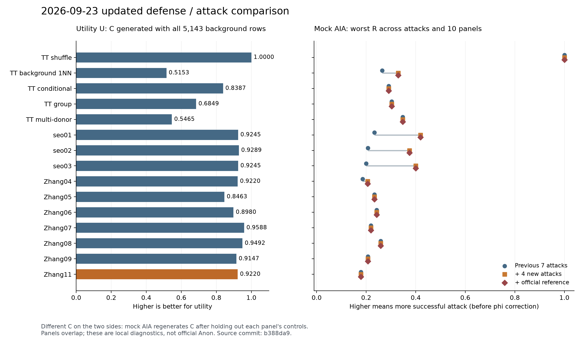
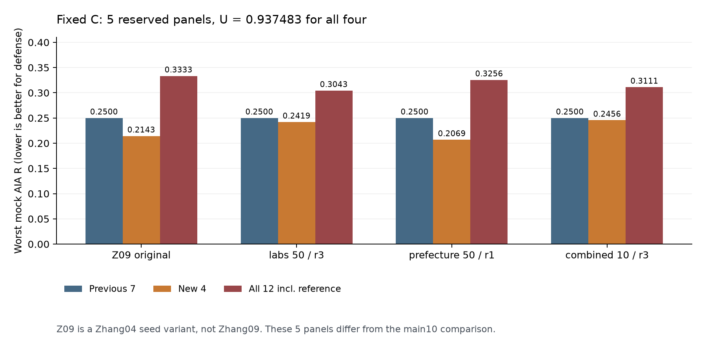

# 0923 加工・攻撃バトル結果

**AIA 2,085比較・MIA 76比較がすべて成功。** 15加工案に対し、更新された攻撃案を含む本戦データの模擬バトルを実行した。0921と重なる980比較を再現し、旧パネル生成C 140個もバイト一致した。

## 読む順番

1. [結果と解釈](説明.md)
2. [全体集計Excel](summary/全体集計.xlsx)
3. [加工15案の比較CSV](summary/加工15案の比較.csv)・[固定C4案の比較CSV](summary/固定C4案の比較.csv)
4. [実行条件と検証記録](条件と検証/実行条件.md)

今回の条件では、zhang_11の最大AIA Rは**0.1786**、zhang_04は**0.2055**。低いほど防御側に有利。本戦全入力から生成したCのUは両方**0.9220**だった。【ローカル自己採点・模擬実験】

U表のCと模擬攻撃パネルのCは生成背景が異なる。公式AnonやCodaBenchの提出結果ではなく、φ=0.089047も模擬課題へ適用していない。詳細は説明書を参照。

`python3 分析.py`で同梱CSVとファイルハッシュを照合できる。集計資料のみを収録し、個票・課題と正解・人物別回答・生成C・トークンは含めていない。
