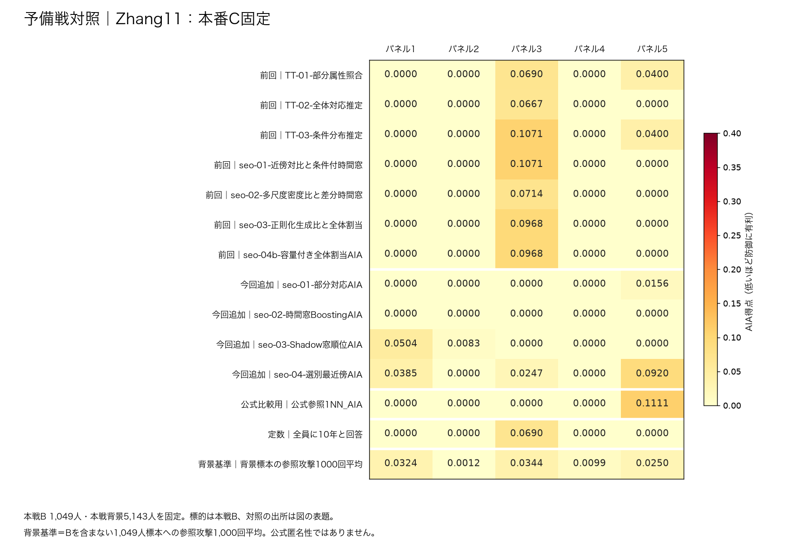
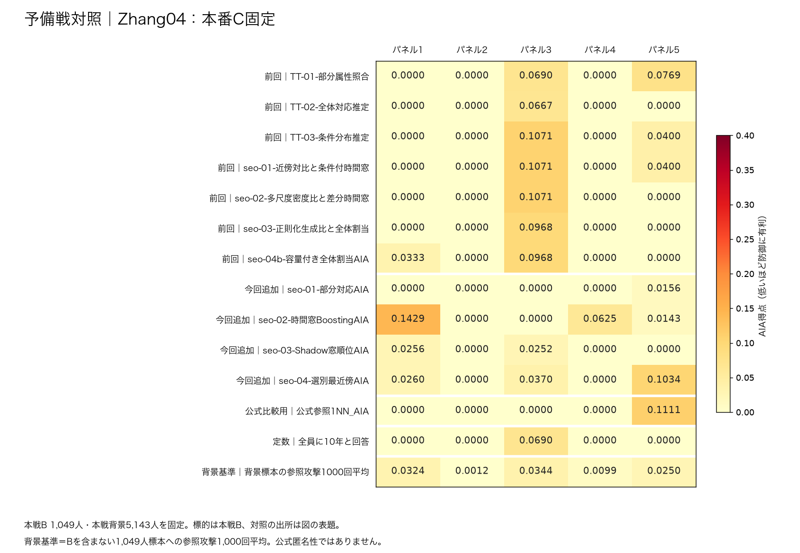
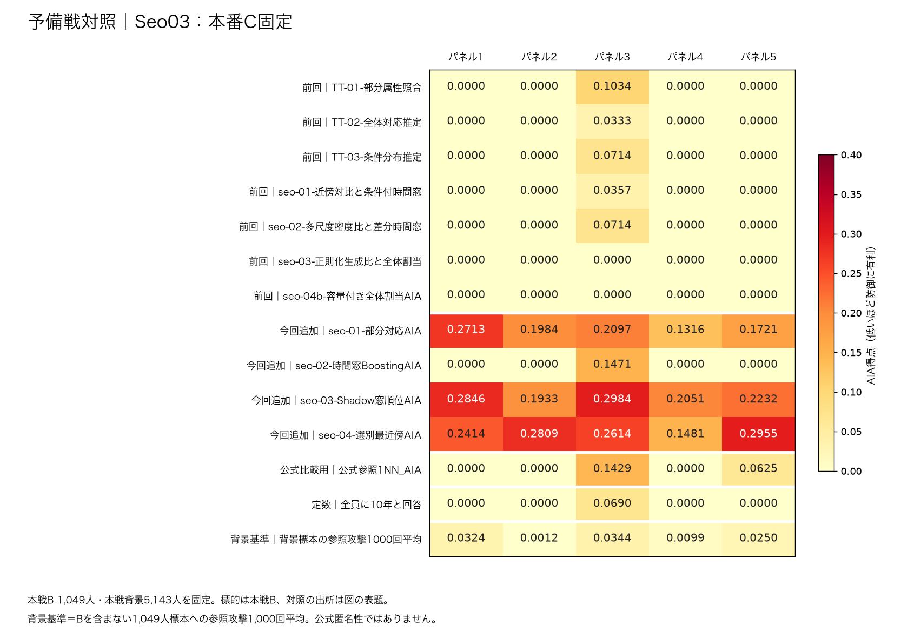
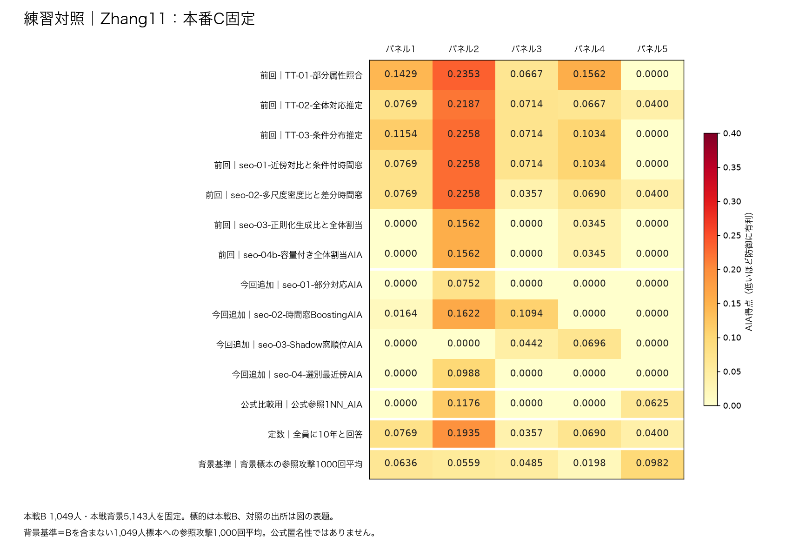
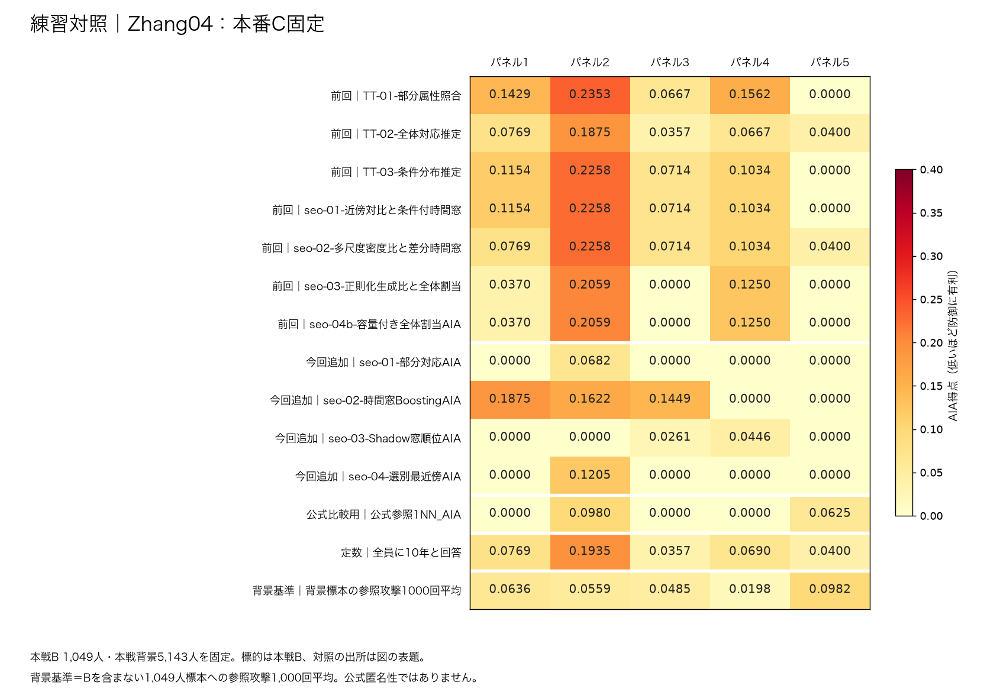
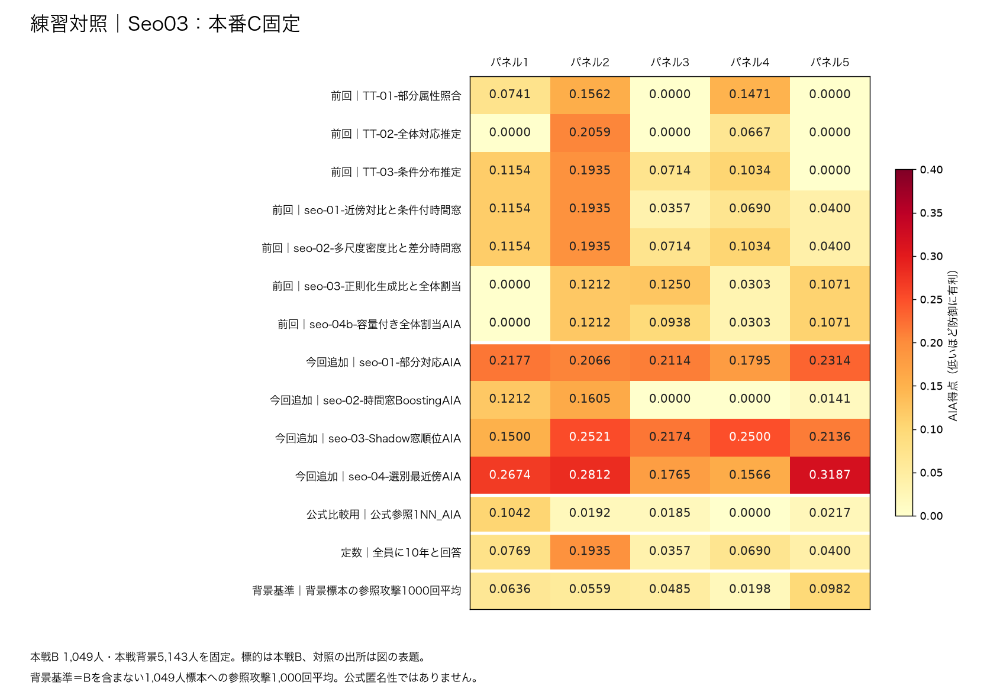

# 本番Cを固定して、Zhangさんのパネルで比較

- **本戦B 1,049人と本戦背景5,143人をそのまま使用。** Zhang11・Zhang04・Seo03の3つのCを、全パネルで固定しました。
- Zhangさんの `prelim` 5組と `practice` 5組を使用。**標的は両方とも本戦Bの人で、異なるのは対照の出所です。**
- 各組は標的163人＋対照163人。対照は本戦B・本戦背景に含まれません。
- Zhangさんの本戦背景由来の対照（`main`）は、背景に正解が含まれるため今回は使っていません。全背景を残すため、背景の外にいる対照を使いました。
- 3案×12攻撃×10組＝**360件**。AIAは低いほど防御に有利、Uは高いほどよい値です。【模擬実験・ローカル自己採点】
- このページの「パネル1〜5」は、各対照系統内の番号です。前回の本戦対照10組・交換候補の5組とは別です。

## まず見る比較

- **今回の3案ではZhang11が有力です。** Zhang04とUが同じで、AIA最大値は予備戦対照で低く、練習対照では同じでした。中央値は両系統で低い値でした。
- Seo03はUが約0.0025高い一方、AIA最大値は両系統で最も高くなりました。
- 対照による差は残ります。例えばZhang11の最大値は0.1111と0.2353です。低い方だけを本番予測として採用しません。
- 各パネルの12攻撃最大を取り、5個の値を集計しました。2系統は混ぜません。
- **UとAIAは、同じ具体的なCの評価です。** パネルごとにCを作り直していません。

| 対照の出所 | 加工案 | U ↑ | 最小 | 中央値 | 平均 | 最大 | 定数込み最大 |
| --- | --- | --- | --- | --- | --- | --- | --- |
| 予備戦対照 | Zhang11 | 0.9220 | 0.0000 | 0.0504 | 0.0554 | 0.1111 | 0.1111 |
| 予備戦対照 | Zhang04 | 0.9220 | 0.0000 | 0.1071 | 0.0847 | 0.1429 | 0.1429 |
| 予備戦対照 | Seo03 | 0.9245 | 0.2051 | 0.2846 | 0.2729 | 0.2984 | 0.2984 |
| 練習対照 | Zhang11 | 0.9220 | 0.0625 | 0.1429 | 0.1413 | 0.2353 | 0.2353 |
| 練習対照 | Zhang04 | 0.9220 | 0.0625 | 0.1562 | 0.1573 | 0.2353 | 0.2353 |
| 練習対照 | Seo03 | 0.9245 | 0.2174 | 0.2674 | 0.2670 | 0.3187 | 0.3187 |

## AIA最大値から背景基準を引くと？

- **匿名性得点につながる指標です。** 同じパネルで `差引後 = max(0, AIA最大値 − 背景基準)` を計算します。小さいほど防御に有利です。
- 下表は、各系統5パネルのうち**差引後が最大になったパネル**の内訳です。「全パネルのAIA最大」から、別パネルの基準や基準の平均を引く計算はしません。
- AIA最大値には定数回答も含めています。今回は全30組で、定数を含めても12攻撃の最大値と同じでした。
- 右端は、MIAと希少AIAを考えずに `1 − 差引後` とした参考値です。**公式Anonや本番得点の保証値ではありません。**

| 対照 | 加工案 | 差引後が最大のパネル | そのパネルのAIA最大 | 同じパネルの背景基準 | **差引後 ↓** | 1−差引後（参考）↑ |
| --- | --- | --- | --- | --- | --- | --- |
| 予備戦対照 | Zhang11 | 5 | 0.1111 | 0.0250 | 0.0861 | 0.9139 |
| 予備戦対照 | Zhang04 | 1 | 0.1429 | 0.0324 | 0.1104 | 0.8896 |
| 予備戦対照 | Seo03 | 2 | 0.2809 | 0.0012 | 0.2797 | 0.7203 |
| 練習対照 | Zhang11 | 2 | 0.2353 | 0.0559 | 0.1794 | 0.8206 |
| 練習対照 | Zhang04 | 2 | 0.2353 | 0.0559 | 0.1794 | 0.8206 |
| 練習対照 | Seo03 | 4 | 0.2500 | 0.0198 | 0.2302 | 0.7698 |

- **Zhang11・予備戦対照の例**：パネル5で `0.111111 − 0.025003 = 0.086108`。AIAだけの参考値は `1 − 0.086108 = 0.913892` です。
- **Seo03は、差し引き前と後で最悪パネルが変わります。** 予備戦対照はパネル3→2、練習対照はパネル5→4です。背景基準がパネルごとに違うためです。
- [背景基準との差の要約CSV](背景基準との差_要約.csv)に、差引後5パネルの最小・中央値・平均・最大も収録しています。Excel「まとめ」の下段でも内訳を確認できます。

### 匿名性得点との関係

- **本番のAIA減点**：`max(0, 全攻撃者のAIA最大値（全体・希少の悪い方） − 公式φ)`。
- **本番の匿名性得点**：`Anon = 1 − max(MIA減点, AIA減点)`。MIA減点は公式の集計・補正をした値です。
- 本番でMIA減点がAIA減点以下なら、Anonは `1 − AIA減点` になります。MIAの方が大きければ、Anonはさらに低くなります。
- 我々の本番の公式φは **0.089047**。今回の模擬パネルとは標的・対照が違うため、今回の得点には各パネル専用の背景基準を使っています。
- 今回は全体AIA・試した12攻撃の比較です。希少AIA・実際の他チームの攻撃・MIAを含む公式Anonは未算出です。【公式ルールに基づく整理／模擬実験】
- 採点式の根拠：配布版ルールブック `main-process-20260912` §6.2（p.19）・§6.2.2（p.21）。希少AIAには公式の誤差補正があります。

全30組の「AIA最大 − 背景基準」を見る

| 対照 | 加工案 | パネル | AIA最大 | 背景基準 | 差引後（0未満は0） |
| --- | --- | --- | --- | --- | --- |
| 予備戦対照 | Zhang11 | 1 | 0.0504 | 0.0324 | 0.0180 |
| 予備戦対照 | Zhang11 | 2 | 0.0083 | 0.0012 | 0.0071 |
| 予備戦対照 | Zhang11 | 3 | 0.1071 | 0.0344 | 0.0728 |
| 予備戦対照 | Zhang11 | 4 | 0.0000 | 0.0099 | 0.0000 |
| 予備戦対照 | Zhang11 | 5 | 0.1111 | 0.0250 | 0.0861 |
| 予備戦対照 | Zhang04 | 1 | 0.1429 | 0.0324 | 0.1104 |
| 予備戦対照 | Zhang04 | 2 | 0.0000 | 0.0012 | 0.0000 |
| 予備戦対照 | Zhang04 | 3 | 0.1071 | 0.0344 | 0.0728 |
| 予備戦対照 | Zhang04 | 4 | 0.0625 | 0.0099 | 0.0526 |
| 予備戦対照 | Zhang04 | 5 | 0.1111 | 0.0250 | 0.0861 |
| 予備戦対照 | Seo03 | 1 | 0.2846 | 0.0324 | 0.2521 |
| 予備戦対照 | Seo03 | 2 | 0.2809 | 0.0012 | 0.2797 |
| 予備戦対照 | Seo03 | 3 | 0.2984 | 0.0344 | 0.2640 |
| 予備戦対照 | Seo03 | 4 | 0.2051 | 0.0099 | 0.1953 |
| 予備戦対照 | Seo03 | 5 | 0.2955 | 0.0250 | 0.2705 |
| 練習対照 | Zhang11 | 1 | 0.1429 | 0.0636 | 0.0792 |
| 練習対照 | Zhang11 | 2 | 0.2353 | 0.0559 | 0.1794 |
| 練習対照 | Zhang11 | 3 | 0.1094 | 0.0485 | 0.0609 |
| 練習対照 | Zhang11 | 4 | 0.1562 | 0.0198 | 0.1364 |
| 練習対照 | Zhang11 | 5 | 0.0625 | 0.0982 | 0.0000 |
| 練習対照 | Zhang04 | 1 | 0.1875 | 0.0636 | 0.1239 |
| 練習対照 | Zhang04 | 2 | 0.2353 | 0.0559 | 0.1794 |
| 練習対照 | Zhang04 | 3 | 0.1449 | 0.0485 | 0.0964 |
| 練習対照 | Zhang04 | 4 | 0.1562 | 0.0198 | 0.1364 |
| 練習対照 | Zhang04 | 5 | 0.0625 | 0.0982 | 0.0000 |
| 練習対照 | Seo03 | 1 | 0.2674 | 0.0636 | 0.2038 |
| 練習対照 | Seo03 | 2 | 0.2812 | 0.0559 | 0.2253 |
| 練習対照 | Seo03 | 3 | 0.2174 | 0.0485 | 0.1689 |
| 練習対照 | Seo03 | 4 | 0.2500 | 0.0198 | 0.2302 |
| 練習対照 | Seo03 | 5 | 0.3187 | 0.0982 | 0.2204 |

## Cを見なくても出る得点

- **定数10年**：誰に対しても10年と回答します。
- **背景標本基準**：本戦背景から1,049人を無作為抽出したCに、公式参照1NNを当てます。1,000回の得点平均です。元Bの人は含みません。
- 公式のφを作る考え方に沿った、**今回の模擬パネル専用の全体AIA基準**です。本番φ＝0.089047とは別です。標本分布の5〜95%範囲は本番得点の信頼区間ではありません。

| 対照 | パネル | 定数10年 | 背景標本平均 | 背景標本5% | 背景標本95% |
| --- | --- | --- | --- | --- | --- |
| 予備戦対照 | 1 | 0.0000 | 0.0324 | 0.0000 | 0.1455 |
| 予備戦対照 | 2 | 0.0000 | 0.0012 | 0.0000 | 0.0000 |
| 予備戦対照 | 3 | 0.0690 | 0.0344 | 0.0000 | 0.1458 |
| 予備戦対照 | 4 | 0.0000 | 0.0099 | 0.0000 | 0.0741 |
| 予備戦対照 | 5 | 0.0000 | 0.0250 | 0.0000 | 0.1373 |
| 練習対照 | 1 | 0.0769 | 0.0636 | 0.0000 | 0.2000 |
| 練習対照 | 2 | 0.1935 | 0.0559 | 0.0000 | 0.1841 |
| 練習対照 | 3 | 0.0357 | 0.0485 | 0.0000 | 0.1778 |
| 練習対照 | 4 | 0.0690 | 0.0198 | 0.0000 | 0.1137 |
| 練習対照 | 5 | 0.0400 | 0.0982 | 0.0000 | 0.2500 |

## 本番得点の予測として使える範囲

- パネルごとの **定数込み最大 − 背景標本基準**を、0未満なら0にした値も記録しています。これは「模擬基準差引後」です。
- 1からその値を引いた「AIAだけの参考保護値」もCSV・Excelに記録しています。**本番の匿名性Anonの予測値としては扱いません。**
- 真の希少対照ラベル、実際の非共有標的、他チームの攻撃・MIAがないため、公式Anon全体は計算できません。
- 本番Anonは `1 − max(MIA成分, AIA成分)`。今回測ったのは全体AIAだけです。希少者やMIAで、さらに低くなる可能性があります。
- 対照は予備戦・練習用という別の分布です。2系統で順位や値が変わる場合、その不確実性を残して判断します。
- 標的は同じ本戦Bから繰り返し抽出され、人物が重なります。10組を独立な10集団とは扱いません。
- 今回の3つのC・攻撃設定は採点前に固定しました。今回の点数を見てCや攻撃を調整していません。

## 各攻撃×各パネル

- 前回＝9月21日から使っている7攻撃、今回追加＝9月23日に追加した4攻撃、公式比較用＝参照1NN。
- 図の色の範囲は全6枚で共通。最後の2行は定数と背景標本基準です。
- [Excel](本番C固定_Zhangパネル比較.xlsx)に全得点・的中人数・統計・基準との差を収録しました。

### 予備戦対照／Zhang11

| 区分 | 攻撃手法 | 最小 | 中央値 | 平均 | 最大 |
| --- | --- | --- | --- | --- | --- |
| 前回 | TT-01-部分属性照合 | 0.0000 | 0.0000 | 0.0218 | 0.0690 |
| 前回 | TT-02-全体対応推定 | 0.0000 | 0.0000 | 0.0133 | 0.0667 |
| 前回 | TT-03-条件分布推定 | 0.0000 | 0.0000 | 0.0294 | 0.1071 |
| 前回 | seo-01-近傍対比と条件付時間窓 | 0.0000 | 0.0000 | 0.0214 | 0.1071 |
| 前回 | seo-02-多尺度密度比と差分時間窓 | 0.0000 | 0.0000 | 0.0143 | 0.0714 |
| 前回 | seo-03-正則化生成比と全体割当 | 0.0000 | 0.0000 | 0.0194 | 0.0968 |
| 前回 | seo-04b-容量付き全体割当AIA | 0.0000 | 0.0000 | 0.0194 | 0.0968 |
| 今回追加 | seo-01-部分対応AIA | 0.0000 | 0.0000 | 0.0031 | 0.0156 |
| 今回追加 | seo-02-時間窓BoostingAIA | 0.0000 | 0.0000 | 0.0000 | 0.0000 |
| 今回追加 | seo-03-Shadow窓順位AIA | 0.0000 | 0.0000 | 0.0117 | 0.0504 |
| 今回追加 | seo-04-選別最近傍AIA | 0.0000 | 0.0247 | 0.0310 | 0.0920 |
| 公式比較用 | 公式参照1NN_AIA | 0.0000 | 0.0000 | 0.0222 | 0.1111 |

### 予備戦対照／Zhang04

| 区分 | 攻撃手法 | 最小 | 中央値 | 平均 | 最大 |
| --- | --- | --- | --- | --- | --- |
| 前回 | TT-01-部分属性照合 | 0.0000 | 0.0000 | 0.0292 | 0.0769 |
| 前回 | TT-02-全体対応推定 | 0.0000 | 0.0000 | 0.0133 | 0.0667 |
| 前回 | TT-03-条件分布推定 | 0.0000 | 0.0000 | 0.0294 | 0.1071 |
| 前回 | seo-01-近傍対比と条件付時間窓 | 0.0000 | 0.0000 | 0.0294 | 0.1071 |
| 前回 | seo-02-多尺度密度比と差分時間窓 | 0.0000 | 0.0000 | 0.0214 | 0.1071 |
| 前回 | seo-03-正則化生成比と全体割当 | 0.0000 | 0.0000 | 0.0194 | 0.0968 |
| 前回 | seo-04b-容量付き全体割当AIA | 0.0000 | 0.0000 | 0.0260 | 0.0968 |
| 今回追加 | seo-01-部分対応AIA | 0.0000 | 0.0000 | 0.0031 | 0.0156 |
| 今回追加 | seo-02-時間窓BoostingAIA | 0.0000 | 0.0143 | 0.0439 | 0.1429 |
| 今回追加 | seo-03-Shadow窓順位AIA | 0.0000 | 0.0000 | 0.0102 | 0.0256 |
| 今回追加 | seo-04-選別最近傍AIA | 0.0000 | 0.0260 | 0.0333 | 0.1034 |
| 公式比較用 | 公式参照1NN_AIA | 0.0000 | 0.0000 | 0.0222 | 0.1111 |

### 予備戦対照／Seo03

| 区分 | 攻撃手法 | 最小 | 中央値 | 平均 | 最大 |
| --- | --- | --- | --- | --- | --- |
| 前回 | TT-01-部分属性照合 | 0.0000 | 0.0000 | 0.0207 | 0.1034 |
| 前回 | TT-02-全体対応推定 | 0.0000 | 0.0000 | 0.0067 | 0.0333 |
| 前回 | TT-03-条件分布推定 | 0.0000 | 0.0000 | 0.0143 | 0.0714 |
| 前回 | seo-01-近傍対比と条件付時間窓 | 0.0000 | 0.0000 | 0.0071 | 0.0357 |
| 前回 | seo-02-多尺度密度比と差分時間窓 | 0.0000 | 0.0000 | 0.0143 | 0.0714 |
| 前回 | seo-03-正則化生成比と全体割当 | 0.0000 | 0.0000 | 0.0000 | 0.0000 |
| 前回 | seo-04b-容量付き全体割当AIA | 0.0000 | 0.0000 | 0.0000 | 0.0000 |
| 今回追加 | seo-01-部分対応AIA | 0.1316 | 0.1984 | 0.1966 | 0.2713 |
| 今回追加 | seo-02-時間窓BoostingAIA | 0.0000 | 0.0000 | 0.0294 | 0.1471 |
| 今回追加 | seo-03-Shadow窓順位AIA | 0.1933 | 0.2232 | 0.2409 | 0.2984 |
| 今回追加 | seo-04-選別最近傍AIA | 0.1481 | 0.2614 | 0.2454 | 0.2955 |
| 公式比較用 | 公式参照1NN_AIA | 0.0000 | 0.0000 | 0.0411 | 0.1429 |

### 練習対照／Zhang11

| 区分 | 攻撃手法 | 最小 | 中央値 | 平均 | 最大 |
| --- | --- | --- | --- | --- | --- |
| 前回 | TT-01-部分属性照合 | 0.0000 | 0.1429 | 0.1202 | 0.2353 |
| 前回 | TT-02-全体対応推定 | 0.0400 | 0.0714 | 0.0948 | 0.2187 |
| 前回 | TT-03-条件分布推定 | 0.0000 | 0.1034 | 0.1032 | 0.2258 |
| 前回 | seo-01-近傍対比と条件付時間窓 | 0.0000 | 0.0769 | 0.0955 | 0.2258 |
| 前回 | seo-02-多尺度密度比と差分時間窓 | 0.0357 | 0.0690 | 0.0895 | 0.2258 |
| 前回 | seo-03-正則化生成比と全体割当 | 0.0000 | 0.0000 | 0.0381 | 0.1562 |
| 前回 | seo-04b-容量付き全体割当AIA | 0.0000 | 0.0000 | 0.0381 | 0.1562 |
| 今回追加 | seo-01-部分対応AIA | 0.0000 | 0.0000 | 0.0150 | 0.0752 |
| 今回追加 | seo-02-時間窓BoostingAIA | 0.0000 | 0.0164 | 0.0576 | 0.1622 |
| 今回追加 | seo-03-Shadow窓順位AIA | 0.0000 | 0.0000 | 0.0228 | 0.0696 |
| 今回追加 | seo-04-選別最近傍AIA | 0.0000 | 0.0000 | 0.0198 | 0.0988 |
| 公式比較用 | 公式参照1NN_AIA | 0.0000 | 0.0000 | 0.0360 | 0.1176 |

### 練習対照／Zhang04

| 区分 | 攻撃手法 | 最小 | 中央値 | 平均 | 最大 |
| --- | --- | --- | --- | --- | --- |
| 前回 | TT-01-部分属性照合 | 0.0000 | 0.1429 | 0.1202 | 0.2353 |
| 前回 | TT-02-全体対応推定 | 0.0357 | 0.0667 | 0.0814 | 0.1875 |
| 前回 | TT-03-条件分布推定 | 0.0000 | 0.1034 | 0.1032 | 0.2258 |
| 前回 | seo-01-近傍対比と条件付時間窓 | 0.0000 | 0.1034 | 0.1032 | 0.2258 |
| 前回 | seo-02-多尺度密度比と差分時間窓 | 0.0400 | 0.0769 | 0.1035 | 0.2258 |
| 前回 | seo-03-正則化生成比と全体割当 | 0.0000 | 0.0370 | 0.0736 | 0.2059 |
| 前回 | seo-04b-容量付き全体割当AIA | 0.0000 | 0.0370 | 0.0736 | 0.2059 |
| 今回追加 | seo-01-部分対応AIA | 0.0000 | 0.0000 | 0.0136 | 0.0682 |
| 今回追加 | seo-02-時間窓BoostingAIA | 0.0000 | 0.1449 | 0.0989 | 0.1875 |
| 今回追加 | seo-03-Shadow窓順位AIA | 0.0000 | 0.0000 | 0.0141 | 0.0446 |
| 今回追加 | seo-04-選別最近傍AIA | 0.0000 | 0.0000 | 0.0241 | 0.1205 |
| 公式比較用 | 公式参照1NN_AIA | 0.0000 | 0.0000 | 0.0321 | 0.0980 |

### 練習対照／Seo03

| 区分 | 攻撃手法 | 最小 | 中央値 | 平均 | 最大 |
| --- | --- | --- | --- | --- | --- |
| 前回 | TT-01-部分属性照合 | 0.0000 | 0.0741 | 0.0755 | 0.1562 |
| 前回 | TT-02-全体対応推定 | 0.0000 | 0.0000 | 0.0545 | 0.2059 |
| 前回 | TT-03-条件分布推定 | 0.0000 | 0.1034 | 0.0968 | 0.1935 |
| 前回 | seo-01-近傍対比と条件付時間窓 | 0.0357 | 0.0690 | 0.0907 | 0.1935 |
| 前回 | seo-02-多尺度密度比と差分時間窓 | 0.0400 | 0.1034 | 0.1048 | 0.1935 |
| 前回 | seo-03-正則化生成比と全体割当 | 0.0000 | 0.1071 | 0.0767 | 0.1250 |
| 前回 | seo-04b-容量付き全体割当AIA | 0.0000 | 0.0938 | 0.0705 | 0.1212 |
| 今回追加 | seo-01-部分対応AIA | 0.1795 | 0.2114 | 0.2093 | 0.2314 |
| 今回追加 | seo-02-時間窓BoostingAIA | 0.0000 | 0.0141 | 0.0592 | 0.1605 |
| 今回追加 | seo-03-Shadow窓順位AIA | 0.1500 | 0.2174 | 0.2166 | 0.2521 |
| 今回追加 | seo-04-選別最近傍AIA | 0.1566 | 0.2674 | 0.2401 | 0.3187 |
| 公式比較用 | 公式参照1NN_AIA | 0.0000 | 0.0192 | 0.0327 | 0.1042 |

## 入力条件とファイル

- 攻撃にはC・問題の公開属性・全本戦背景を渡しました。正解や加工元Bは渡していません。
- CLIが要求する攻撃者Bには、本戦背景から抽出した共通1,049人を使用。実際の他チームBではありません。MIAは評価していません。
- 交換3候補の比較は、この資料にはまだ含めていません。以前の3候補は背景3,347人で作成した別Cです。
- [3案の要約](3案の要約.csv)／[各パネル比較](パネル別比較.csv)／[手法別統計](手法別統計.csv)／[360件の詳細](360件の詳細.csv)
- [Cの識別値とU](評価したCと有用性.csv)／[パネル別基準](パネル別基準.csv)／[背景標本10,000件](背景標本10000件.csv)／[検証記録](条件と検証.json)
- `python3 分析.py` で、同梱の的中人数から集計値を再計算できます。
