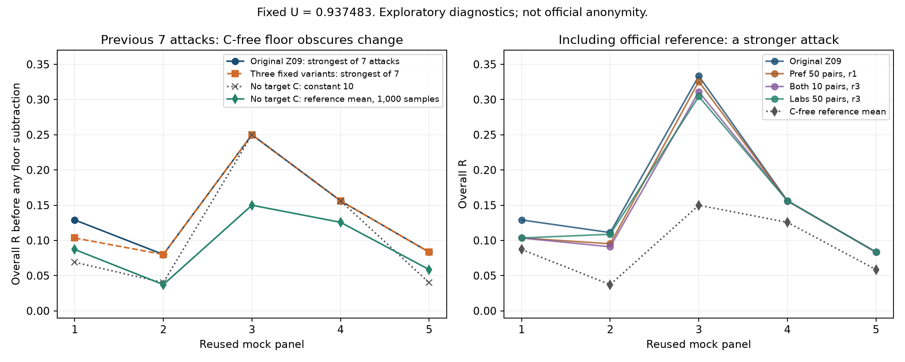

# Z09から派生した属性交換3候補

2026-09-23共有版1.0.0。zhang04の具体的な生成C「Z09」をベースに、有用性を保ちながら属性の対応を変えた3候補です。**追加検証・チーム内比較用であり、採用確定やCodaBench提出済みを意味しません。**

## ダウンロードするC

| C | 変更 | U | 模擬8攻撃の最大R↓ | 主な比較目的 |
|---|---|---:|---:|---|
| [検査値50組r3](C_labs_n50_r3.csv) | SBP・TG・HDL・ALTのうち1列ずつ、合計50組／100行 | 0.937483 | **0.304348** | 今回の固定4候補で最悪AIAが最も低い |
| [都道府県50組r1](C_prefecture_n50_r1.csv) | 都道府県50組／100行 | 0.937483 | 0.325581 | 主要な数値属性を維持して照合を崩す比較 |
| [併用10組r3](C_combined_n10_r3.csv) | 都道府県10組＋検査値10組／40行 | 0.937483 | 0.311111 | 少ない変更量での比較 |
| 元Z09（比較値のみ） | 変更なし | 0.937483 | 0.333333 | 比較基準 |

各Cは1,049行・13列。保存済み候補をバイト単位でそのまま収録しました。3つのCを混ぜたものや平均したものではありません。

**Uは本戦Team28のB・参照値と本戦公式コードによるローカル自己採点、AIA・MIAはCodexの模擬実験です。公式匿名性・最終得点ではありません。**

## この3候補を残した理由と限界

元Cから18候補を作り、元Cを含む19候補を既存7攻撃で比較。その中から、MIAの生TPRを悪化させず、一部パネルの最強AIAを下げた異なる操作の3候補を抽出しました。その後、この3候補と元Cに公式参照攻撃を追加して再評価しました。表はこの8攻撃×5パネルの全体Rの最大値です。19候補すべてを8攻撃で順位づけしたものではありません。

- **有用性**：全候補で元Z09と同じU。元Cの最小項目U_rareを維持しました。各項目の詳細は[候補情報](候補情報.json)に記載。
- **AIA**：従来7攻撃だけなら全候補の最大Rは0.25で同じ。公式参照攻撃を加えると上表の差が出ます。ただし最悪パネルでの「会員的中数−非会員的中数」は15→14という1人分の改善です。別パネル・別攻撃では悪化もありました。
- **MIA**：3攻撃とも元Cと同じTPR。seo-01＝0.038462、seo-02＝0.076923、seo-03＝0.038462。1つの模擬攻撃者Bへの全体評価です。
- **課題の偏り**：最悪パネルでは死亡時期の構成が異なるため、C不使用で「常に10」と答えてもR=0.25になります。背景1,049行標本×1,000回の参照攻撃平均は同パネルで0.149951。これらを公式φと同一視していません。
- **不確実性**：5パネルは再利用され、人物も重複しています。候補選択後の独立確認ではありません。真の希少対照ラベルがないため希少AIA・希少MIAは未評価です。

生TPRから `(TPR−0.01)/0.99` を計算して公式MIA正規化と扱わないでください。公式MIAには実際の攻撃者コホート間集約と20,000回の偶然補正、Kによる正規化が必要です。この共有版は生TPRだけを記載しています。

詳細：[評価比較CSV](評価比較.csv)。`original_7_*`は従来7攻撃、`all_8_*`は公式参照攻撃を加えた比較。`diagnostic_clipped_excess`は模擬参照基準との差であり、公式補正値ではありません。MIAのアルゴリズム間平均も公式攻撃者間平均ではありません。



## 加工方法

ベースは `zhang_04_copula_bgtime`、生成seed **2026092209**。原実装の参照版は [44d2e68](https://github.com/smsaku00/pwscup2026-sutehaji/tree/44d2e68514a81105bd3e0e2ab2b064b8ba2fd6e5)。Cの行順を含むSHA-256は`manifest.json`に記載しました。

都道府県交換では、異なる県の2行を選んでラベルを交換しました。r1のseedは2026092401、併用r3は2026092403。検査値交換r3のseedは2026092503。検査値は同性・同じ10歳年代・公開検出器で非希少の行間で、交換値の差が0.5 IQR以内という条件を満たす組を選びました。他の数値属性で近い上位10行から乱数で選び、交換後も希少境界を越えないことを確認しています。検査値交換では希少と判定された47行の数値属性を固定しました。

各列の値の集合、年齢・性別・BMI・FPG・喫煙・time・onset・deathを維持しました。候補生成時には攻撃結果を見て交換箇所を選んでいません。候補を選抜する段階では既存の攻撃結果を参照しています。

`swaps_*.json`は `[0始まりの行番号i, 行番号j, 列名]` の順序付き交換一覧です。Bの人物IDや会員対応表ではありません。

## ファイル検証と交換の再適用

Python 3.10以上、標準ライブラリのみで実行できます。追加インストールは不要です。

```sh
python3 apply_swaps.py
```

ハッシュ・行列数・列ごとの値の保存・交換を逆に適用すると3候補すべて同一の元Z09へ戻ることを検証します。公式採点の再実行ではありません。

元Z09のCを持っている場合は、次のコマンドで3候補を再生成できます。

```sh
python3 apply_swaps.py --base-c /path/to/Z09/C.csv --out /path/to/replayed
```

入力は行順を含む元Z09のハッシュと一致する必要があります。`--candidate labs_n50_r3`等で1候補にも絞れます。このコードは保存した交換の再適用用であり、新しいBからzhang04を生成するコードではありません。

背景を替えてzhang04を生成すると、同じseedでもこのZ09とは異なるCになります。今回の元Z09は模擬課題の人物を除外した背景3,347行を用いて生成しました。新しいCは別途有用性・攻撃を再評価してください。

入力B・B_self・A_bg・utility_ref・課題・正解・会員対応表・個人別攻撃予測・提出トークンは同梱していません。保存Cの全採点と評価監査は2026-09-22に実施済みです。
