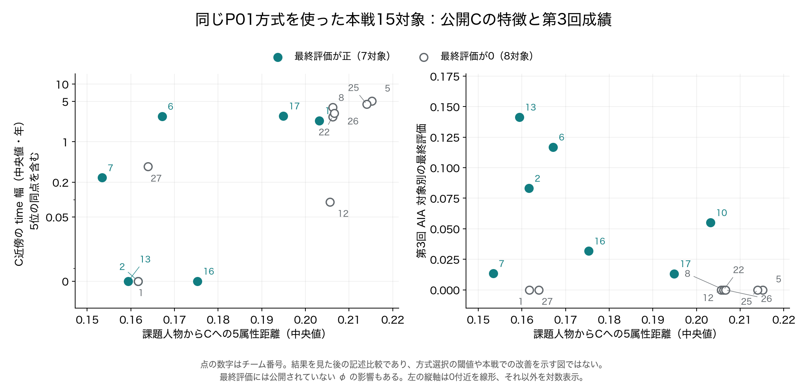

# AIA全体の追加探索まとめ — 2026年10月8日

**全体評価・執筆：ChatGPT。** 田代の補助分析をAIA担当者が検討するための総括であり、担当変更、方式のチーム採用、大会提出を決める文書ではない。

対象は、08:10 JSTへの前倒し依頼で渡された原文26文書と、[根拠掲載コミット `4b181c65`](https://github.com/smsaku00/pwscup2026-sutehaji/commit/4b181c65aba05b9f28467d9bf44f6ccb1b3dd9ff)のコード・JSON・CSV・図である。研究期限は09:00 JST、まとめ依頼は08:10 JSTであり、当初の12:00という記述は旧条件の履歴として扱う。この文書は当該スナップショットの総括で、以後の未掲載変更を含むとは主張しない。[期限変更](共有用/作業期限変更.json)・[依頼時刻変更](共有用/まとめ依頼時刻変更.json)

## 1. 結論

**今回残すべき有望案は、臨床4列の「最近1点の値集合」による選別である。ただし、本戦への一律置換を正当化する段階にはない。** 原記録保持の強い予備戦1・2と自己5を除く加工18対象では、共通全BG参照の平均raw R_allが、P01の0.111736に対して、全4列平均（all4）で0.135405、上位2列平均（top2）で0.142100だった。一方、自己5だけを除く20対象では、P01の0.147998に対して0.133986／0.147806であり、対象の範囲を変えても一律に勝つ結果ではない。[固定比較の平均](属性値集合による選別/集計/予備戦_平均.csv)

この案のキーアイデアは、**同じC行に複数属性が残っていることを要求せず、列ごとに別の行にある近い値も使う**ことである。同性別の人工的な臨床列入替に対して値集合方式は不変だったが、実際の加工が列入替だったことを示してはいない。複数近傍やKDEへの平滑化で良好な結果が維持されなかったことは、「大まかな周辺分布だけではなく、最近値の細かな位置が役立った可能性」と整合する。ただし、これも今回の比較からの限定的な解釈である。[行結合診断](C臨床列の行結合診断/集計/予備戦_20対象と18対象の平均.csv)・[複数近傍](臨床値集合の複数近傍/集計/20対象と18対象の平均.csv)・[KDEの比較](臨床周辺分布の平滑化/集計/予備戦_平均.csv)

**改善を確認できなかった案も成果として残す。** 順位化・周辺分布補正、条件付きtime推定、公開BG一致行の減重・除外、人物別較正、他Cとの差分、C抽出の安定性、属性対統合、C行からの背景対比は、今回の固定条件ではP01の共通全BG基準を上回らなかった。加工特徴による方式選択も条件によって大きく悪化した。したがって、現時点の整理は「P01を比較基準として保存し、k1のall4／top2を次の固定検証候補として残す」であり、「C特徴から各本戦対象の最適方式を選べる」ではない。[ファミリー別集計](候補群の留保監査/集計/family内最大値_同じベンチでの選択.csv)・[39候補ルータの監査](候補群の留保監査/既存分岐へのpool差替/凍結39候補_nested選択の平均.csv)

## 2. 評価の対象・指標・参照条件

### 2.1 「20対象」「18対象」「本戦23C」は別の分母

| 区分 | 対象と用途 |
| --- | --- |
| 予備戦21C | 保存結果の再現・動作診断を含む全公開C。公開予備正解による採点が可能 |
| 予備戦20対象 | 21Cから自己チーム5を除いた比較。各対象に会員163課題・対照163課題 |
| 加工18対象 | 20対象から原記録保持の強い1・2をさらに除いた比較。1・2を「未加工」と確定した分類ではない |
| 本戦23C | 自己チーム28を含む公開C。攻撃相手は22対象。今回の追加方式は基本的に公開入力の特徴・選択動作を診断 |
| 公開背景BG | 各フェーズで5,143行。各Cは1,049行、AIA課題は326行 |

予備戦と本戦で同じチーム番号でも、同じ加工や同じ結果を意味しない。加工18の会員・対照はそれぞれ163×18＝2,934課題の延べ集計であり、独立した実人物が2,934人いるという意味ではない。古い配布前の人数・背景数ではなく、今回の監査条件を基準にする。[共通監査条件](候補群の留保監査/監査条件.json)・[本戦Cの現状監査](現状監査/C基本特徴とGitHub一致.json)・[背景分割条件](基準方式の背景感度/固定プロトコル.json)

### 2.2 raw R_allと公式最終評価を分ける

主指標は、予備戦の各対象で次を計算した後、その対象平均を取る値である。

```text
p_m = timeを±0.5年以内で当てた会員数 / 163
p_c = timeを±0.5年以内で当てた対照数 / 163
raw R_all = max(0, (p_m - p_c) / max(1 - p_c, 1e-9))
```

全対象の平均p_m・p_cからRを計算し直した値ではない。対象別公式最終評価は、保存された現状監査では `clip(max(R_all, R_rare) - φ, 0, 1)` と整理されている。今回の主比較はR_allだけであり、R_rare・R_maxは副指標、未知のφは再現していない。**独自の「実C R − 背景C R」も公式補正後得点ではない。** 予備戦raw Rを本戦リーダーボードへ直接比較しない。[公式結果の区分](現状監査/公式各回と対象別.json)・[集計の方針](候補群の留保監査/監査条件.json)

また、負値を対象ごとに0へ切り上げるため、平均Rが正でも、符号を残した平均的中差が正とは限らない。「選別した人数」「選別した会員数」「会員のtime的中数」「会員と対照の的中差」はそれぞれ別の量として読む。

### 2.3 同じ「独立背景対照」でも実験間で条件が異なる

| 比較条件 | そろえるもの・読み方 |
| --- | --- |
| 共通全BG統一表 | 同じフェーズの全5,143行を参照する実Cの結果。各実験の保存基準の的中数・Rを照合して統一 |
| 各実験の主条件 | 人物別較正・値集合は独立splitが主条件。統一表はそれらの全BG側を採用しており、主条件の寄せ集めではない |
| 初回値集合とその後続のsplit | pool 2,571行／ref 2,572行を非重複に分割。背景Cは実Cと同じ行数・性別人数で抽出。P01のIQR尺度は全BGに固定し、CDF参照を変更 |
| 固定32背景反復 | seedごとに同じ有限BGを再分割。P01のIQRも当該refから再計算。値集合とP01で分割・背景C抽出を合わせて比較 |
| 全BG参照の背景C対照 | 背景Cの標本が参照BGに含まれる条件がある。その場合は重複を持つ補助診断で、独立splitと混ぜない |

初回値集合splitでのP01は0.090402、32背景反復のP01平均は0.087475である。他の実験にも異なる基準値があるが、参照split・尺度・抽出条件が異なる値を直接差し引いて「方式の改善」としない。32反復や20背景C反復は、独立した検証対象を32倍・20倍に増やしたものではない。[値集合の固定条件](属性値集合による選別/固定条件.json)・[32背景の固定条件](属性値集合の背景感度/固定プロトコル.json)

## 3. 本戦第3回までの現状

従来READMEの「本戦での改善は未確認」は、10月7日時点の提案履歴である。今回の現状監査には第3回までの公式結果が保存されている。ただし、第3回はP01だけの試験ではない。

| 本戦・攻撃相手22対象 | 第1回 | 第2回 | 第3回 |
| --- | ---: | ---: | ---: |
| raw AIA全体R平均 | 0.073983 | 0.074787 | 0.128667 |
| 対象別公式最終評価の平均 | 0.046505 | 0.052396 | 0.082461 |
| 会員time的中数の合計 | 2,021 | 2,354 | 2,427 |
| 対照time的中数の合計 | 1,962 | 2,285 | 2,268 |
| 符号付き的中差 | 59 | 69 | 159 |

会員・対照それぞれの分母は163×22＝3,586課題である。第3回の方式はP01が15対象、N2timeが4対象、restoreが2対象、N9plusが1対象だった。**混合方式全体として第2回から改善した事実はあるが、その差をP01単独の因果効果とは評価できない。** 今回のk1値集合等の追加方式を本戦採点した結果でもない。[公式各回の集計](現状監査/公式各回と対象別.json)・[第3回の対象別方式](現状監査/第3回対象別方式.json)・[監査時点と出所](現状監査/GitHub監査レシート.json)

P01を使った15対象だけでは最終評価が正7対象・0が8対象であり、他方式を使った7対象を混ぜた成功率は出さない。最終評価0は、raw Rも0だった、あるいは攻撃信号がなかったことと同義ではない。φと対象別raw Rが不明だからである。

## 4. 基準方式と有望案は何が違うのか

| 段階 | P01：同一C行の部分2属性対応 | k1値集合：臨床列ごとの最近値 |
| --- | --- | --- |
| 数値入力 | age、SBP、TG、HDL、ALT。TG・ALTをlog1p、BGのIQRで尺度化 | SBP、TG、HDL、ALTの原尺度。ageを使わない |
| Cから拾う証拠 | 同じC行で差が小さい2属性 | 各列で最近の値。列によって別のC行でよい |
| BGとの比較 | 課題ごとの部分距離を連続BG-CDFのスコアへ変換 | 列ごとのC最近距離とBG最近距離のlog比 |
| C行の競合 | 12近傍と境界同点を候補にし、C行再利用を許さない部分Hungarian対応 | 同一人物・同一行への対応制約なし。課題を独立に順位付け |
| 最終人数 | 性別ごとに75%の人数制約 | 性別ごとにceil(課題人数×75%) |
| time回答 | 選択者9.5、非選択者0 | 同じ |

値集合の列jの証拠量は次の通りである。大きいほど、公開背景よりCに近い値がある。

```text
d_C,j  = 同性別Cにある列jの値への最小絶対距離
d_BG,j = 同性別BG参照にある列jの値への最小絶対距離
r_j    = log((d_BG,j + 1e-8) / (d_C,j + 1e-8))
all4   = 4列のr_jの平均
top2   = 大きい2列のr_jの平均
```

例えばSBPの証拠がCの行A、TGの証拠が行Bにあってもよい。これは「その課題人物に対応する1行を復元した」という主張ではない。スコアは真の会員確率ではなく、`1e-8`はゼロ距離用の数値上の固定値である。0年も正式な棄権ではなく数値回答である。[実装](属性値集合による選別/分析.py)・[固定仕様](属性値集合による選別/固定条件.json)

主比較では、同一行制約、ageの有無、距離の定義、割当の有無をまとめて変えている。そのため、主比較だけで改善の全てを同一行制約の除去へ帰属させず、後述の反証診断と区別する。

## 5. 最初に凍結した39候補の全体像

統一候補群は、各実験の結果を見た後、全体の候補選択計算に進む前の**06:29:35 JST**に固定された。基準1＋新方式38＝名目39候補である。全探索がこの時刻以前から予備正解と独立だった、という意味ではない。

以下は**共通全BG・加工18対象**にそろえた表である。「最良」は同じベンチマークで各ファミリーの結果を見て選んだ記述値であり、独立な選択性能ではない。

| 変更した部分 | 新候補数 | 今回変えたもの | ファミリー内最良R_all | P01との差 |
| --- | ---: | --- | ---: | ---: |
| P01基準 | — | 同点対応済みの部分2属性・性別75%対応 | 0.111736 | — |
| 順位尺度・周辺分布補正 | 8 | global／sex順位、部分2／全5、sex／sex×県の半量・全量補正 | 0.058497 | -0.053239 |
| 条件付き時間推定 | 6 | 点／区間距離、8／32近傍、最大時間窓、BGとの差、75%選別 | 0.041260 | -0.070476 |
| 公開BG一致行の処理 | 2 | 一致C行の重み0.5／除外 | 0.104377 | -0.007359 |
| 人物別較正 | 4 | 背景Cでの平均／中央値減算、標準化、経験上側順位 | 0.093124 | -0.018612 |
| 人物別較正の厳密計算 | 1 | 同じ帰無分布を超幾何式で計算 | 0.082928 | -0.028808 |
| 他Cとの差による選別 | 4 | 他Cへの近さの中央値／75%点を0.25／1倍減算 | 0.099416 | -0.012320 |
| C抽出による選別の安定性 | 3 | Cの80%抽出を32回行った選択頻度・元スコアとの統合 | 0.100723 | -0.011013 |
| 属性対ごとの証拠統合 | 3 | 10固定ペアをそれぞれBGで尺度調整し、上位1／上位3／全10で統合 | 0.073679 | -0.038057 |
| C行の背景対比 | 4 | C行から課題／BGへの近さを部分2／全5、0.25／1倍で追加 | 0.097737 | -0.013999 |
| 属性値集合による選別 | 3 | all4、top2、一致列数優先＋all4 | **0.142100** | **+0.030364** |

人物別較正の最良0.093124は全BG側の平均減算である。主条件のsplitでは経験順位が0.091276で、同条件基準0.090402に対して+0.000874にとどまり、留保選択平均は0.060438へ低下した。全BGの基準0.111736とsplit側の新方式を混ぜない。[全BGファミリー集計](候補群の留保監査/集計/family内最大値_同じベンチでの選択.csv)・[較正の主比較](背景対照での選別較正/集計/予備戦_平均.csv)・[較正の留保選択](背景対照での選別較正/集計/leave_team_out方式選択.csv)

39候補からは、基準の重複9、C-free等の対照、過去比較、結果閲覧後の時間機構対照を除いている。保存上の役割は計59個であり、それを59個の新方式とは数えない。また値集合のall4と一致列数優先は、実C44組・背景対照で同じ選択になった。名目候補数と異なる予測の数も一致しない。[候補の役割一覧](候補群の留保監査/候補の役割一覧.csv)・[候補プール固定](候補群の留保監査/候補プール固定.json)・[共通全候補表（gzip）](候補群の留保監査/共通全BG_全候補対象別.csv.gz)

### 改善しなかった案から分かったこと

**timeを精密に補完することと、AIAの会員・対照差を作ることは別だった。** 条件付き時間窓＋75%選別の加工18でのRは0.041260。同じ選別で選択者を一律9.5にした対照は0.047709、Cのtimeを性別内で置換した20反復平均は0.042767だった。条件付きQI–time関係の利用による追加利得は確認できない。背景だけの時間補完は会員・対照とも高率に的中しても、AIAの優位には直結しなかった。[時間関係の寄与](条件付き時間推定/集計/時間関係の寄与_平均.csv)

**背景由来に見えるC行を消すだけでは改善しなかった。** BG重み0.5／除外は加工18で改善対象0、平均0.104377／0.097584だった。除外によって独自の背景差し引き値だけが少し上がる条件もあるが、実CのRも大きく低下している。除外後に全員0年となる対照の挙動を、公式φ補正の再現とは呼べない。[BG処理の比較](加工特徴と方式選択/集計/公開BG処理_20対象と18対象平均.csv)・[背景対照](加工特徴と方式選択/集計/公開BG処理_背景対照平均.csv)

**一般的な近さや安定性を減らせばよい、という単純な関係でもなかった。** 他Cの弱い補正はあるsplitで背景との差を少し増やした一方、主参照では全4案が悪化した。C抽出の選択頻度を使った3案も全て基準未満だった。属性ペア統合ではペアの統合方法だけでなく12候補の選び方も変わるため、悪化原因を属性相関だけへ限定できない。[他C対照](他Cとの差による選別/集計/独立背景対照_平均.csv)・[C抽出比較](C抽出による選別の安定性/集計/予備戦_20対象と18対象平均.csv)・[ペア統合条件](属性対ごとの証拠統合/事前固定仕様.json)

## 6. k1値集合の改善はどこに現れたか

### 6.1 固定方式としての平均と対象別の勝敗

| 方式 | 全BG・20対象 | 全BG・加工18 | 初回split・加工18実C | 同split・背景C平均 | 同split・実C−背景C |
| --- | ---: | ---: | ---: | ---: | ---: |
| P01 | 0.147998 | 0.111736 | 0.090402 | 0.049349 | 0.041052 |
| k1 all4 | 0.133986 | 0.135405 | 0.136335 | 0.034380 | 0.101955 |
| k1 top2 | 0.147806 | 0.142100 | 0.133838 | 0.032991 | 0.100847 |

加工18の全BGではall4・top2とも**7対象改善／8対象悪化／3対象同値**だった。top2には予備4の0.015873→0.418919、22の0→0.289855など大きな改善がある一方、12の0.218750→0、20の0.151515→0など大きな悪化もある。全体平均の改善を「ほとんどの対象で安定して勝った」とは表現できない。[平均](属性値集合による選別/集計/予備戦_平均.csv)・[対象別と反復（gzip）](属性値集合による選別/集計/予備戦_対象別と20反復null.csv.gz)

### 6.2 選ばれた会員が増えても、time的中は増えるとは限らない

9.5／0回答では、選択されて真timeが9〜10年、または非選択で真timeが0〜0.5年のときだけ的中する。その他の時間帯では両回答とも外れる。

| 全BG・加工18、P01との差 | k1 all4 | k1 top2 |
| --- | ---: | ---: |
| 選択された会員課題数 | +16 | +8 |
| 会員time的中数 | +3 | **-4** |
| 対照time的中数 | -27 | -23 |
| 符号付き的中差の増分 | +30 | +19 |
| 対象平均raw Rの差 | +0.023669 | +0.030364 |
| 0切り上げ前R平均の差 | +0.014748 | +0.005028 |
| 0切り上げの寄与の差 | +0.008921 | +0.025335 |

top2は会員の選択が8件増えても、会員のtime的中は4件減った。改善には、対照の的中がより減ったことと、対象別0切り上げの影響がある。all4の対照的中減27件は全て長時間区分、top2の対照的中減23件は長時間21件と早期2件だった。これは採点定義に沿った既存予測の分解で、会員推定の別課題の性能ではない。[選択会員数と対照数](属性値集合の的中内訳/集計/選択会員数と対照数_合計.csv)・[時間帯内訳](属性値集合の的中内訳/集計/選別切替_区分別合計.csv)・[的中差と0切り上げ](候補群の留保監査/集計/的中差と0切り上げ_全候補.csv)

all4とtop2のどちらを残すかも、平均Rの1列だけで決めない。全BGの平均Rではtop2、初回splitの平均Rと全BGの符号付き的中差ではall4が優位であり、今回の根拠では両者を固定候補として残すのが妥当である。

## 7. 有望結果を見た後の機構診断

ここからの反証・感度監査は結果閲覧後の分析であり、元の39候補へ遡及追加しない。

### 7.1 Hungarianを外しただけでよいのか

旧pairスコアを保ち、選別だけ独立sex75へ変えた対照は、加工18・全BGで0.087345とP01未満だった。また、値集合と同じ臨床列log比・独立選別を使い、C側を同じ行に制約した対照はall4が0.068995、top2が0.093109で、値集合の0.135405／0.142100を下回った。splitでも同じ方向だった。

したがって、この条件では「割当をやめただけ」で主結果を説明する観測ではなく、同一行制約を外したことの有用性を支持する。ただし事後に固定した対照であり、実際の加工機構や未知本戦での効果の証明ではない。[交絡反証の平均](属性値集合による選別/後付けの交絡反証/集計/主候補と後付け対照の平均.csv)・[追加固定条件](属性値集合による選別/後付けの交絡反証/追加固定条件.json)

### 7.2 臨床列を人工的に入れ替えるとどうなるか

全44CでSBP・TG・HDL・ALTを、同性別内で列ごとに独立に行入替し、20回反復した。age・prefecture・sex・time等の非臨床列は元の行に保存した。

| 加工18・全BG | 原本C | 列入替後20反復平均 |
| --- | ---: | ---: |
| P01 | 0.111736 | 0.054119 |
| k1 all4 | 0.135405 | 0.135405 |
| k1 top2 | 0.142100 | 0.142100 |

この操作は臨床列同士だけでなく、**臨床列とage・time等の行対応も壊す。** したがってP01の低下を臨床列間相関だけの効果と断定しない。P01の対象別変化も7改善／11悪化で一方向ではない。値集合の不変性は、列ごとの値集合しか使わない定義から必要になる性質で、独立な性能検証ではない。[原本と交換の平均](C臨床列の行結合診断/集計/予備戦_20対象と18対象の平均.csv)・[対象別変化](C臨床列の行結合診断/集計/臨床列交換の影響_予備対象別.csv)

交換後P01は、0切り上げ前R平均が-0.003313、切り上げ寄与が+0.057432で、raw R平均が+0.054119になった。正の平均Rだけを漏洩の証拠にしない。また、age等や性別内の周辺値は残るので、この人工Cを完全な情報なし対照とも呼べない。実際の参加者が列入替を用いた証拠ではない。[影響の分解](C臨床列の行結合診断/集計/臨床列交換の影響_平均と対象間ばらつき.csv)

### 7.3 単純な公開値コピーの発見なのか

値集合の追加監査では、全44C・両参照で課題の臨床値が同性別BG参照へ1e-8以内で一致した属性セルは0だった。本戦課題のC側でも4列一致・3列一致は全Cで0、2列一致はC3の2課題だけだった。したがって今回の差を、容易なBG厳密一致対照の排除や、広範な臨床値の完全コピー発見だけでは説明できない。一方、近接や周辺分布が寄与しないことまで否定したわけではない。[BG一致区分の確認](属性値集合による選別/BG一致区分の確認.json)・[課題の一致属性数分布](属性値集合による選別/集計/課題の一致属性数分布.csv)

## 8. 背景参照を32通り変えた感度

同じ分割・同性別背景C抽出を使った加工18の比較である。各seedの実Cと20背景Cの対象平均を取り、32seedで集計した。最良seedの選択はしていない。

| 方式 | 実C Rの32平均 | seed間の最小〜最大 | 背景C Rの32平均 | 実C−背景C R | 符号付き的中差の実C−背景C |
| --- | ---: | --- | ---: | ---: | ---: |
| P01 | 0.087475 | 0.063139〜0.104581 | 0.032008 | 0.055467 | 6.475608人 |
| k1 all4 | 0.133079 | 0.110436〜0.153450 | 0.031905 | 0.101175 | 9.273438人 |
| k1 top2 | 0.136973 | 0.113581〜0.154949 | 0.034098 | 0.102874 | 9.159201人 |

実CのRとR超過では、all4・top2とも同一seedのP01を32／32で上回った。ただし、符号付き的中差の超過の改善はall4で30／32、top2で29／32であり、全seedで同じ符号ではない。今回の良好結果が「たった1分割の偶然」だけだったとは考えにくくなるが、同じ予備対象の再利用という限界は消えない。[P01の感度分布](基準方式の背景感度/集計/32参照の感度分布_独立検証区間ではない.csv)・[値集合の感度分布](属性値集合の背景感度/集計/32参照_感度分布_独立検証区間ではない.csv)・[同一分割での比較](属性値集合の背景感度/集計/同一分割での旧基準比較.csv)

**平均Rの頑健さと、誰が選ばれるかの安定性は違う。** 全BGから各半数参照へ変えた本戦23Cの選択変更は、P01が平均28.546課題、all4が51.595課題、top2が53.342課題だった。Jaccard平均は順に0.890127、0.809753、0.803935。変更数は「外れた行」と「新たに入った行」の両方を数える。性別内の選択人数が同じでも中身は変わる。[P01の選択変化](基準方式の背景感度/集計/選択変化の32参照要約.csv)・[値集合の選択変化（gzip）](属性値集合の背景感度/集計/32参照_全BGからの選別変化_対象別性別.csv.gz)

これらの本戦値は正誤不明の動作診断である。選択頻度を会員確率と解釈しない。また、BG人数・構成・P01のIQRが同時に変わる比較であり、変動原因を人数だけへ分離してはいない。

## 9. 第二段階の追加探索：複数近傍・KDE・背景質量

k1の良好結果や感度を見て発想した後続案である。新予測・採点前に各候補を固定したが、着想は結果閲覧後であり、**初回39候補には含めない。** 以下の主な対照は初回値集合と同じsplitで、32背景監査とは別条件である。

| 後続方式 | 固定した変更 | 加工18・全BG実C R | 加工18・split実C R | 同split・実C−背景C R |
| --- | --- | ---: | ---: | ---: |
| k3 all4 | 各列を最近1点から第3近傍へ | 0.117358 | 0.091540 | 0.056584 |
| k3 top2 | 同上、上位2列で集約 | 0.108451 | 0.117322 | 0.073638 |
| k8 all4 | 第8近傍へ | 0.069161 | 0.058450 | 0.039003 |
| k8 top2 | 同上、上位2列で集約 | 0.087862 | 0.067640 | 0.046446 |
| KDE all4 | 固定帯域Gaussian KDEの列別log密度比 | 0.034473 | 0.041087 | -0.008231 |
| KDE top2 | 同上、上位2列で集約 | 0.036483 | 0.050907 | 0.012193 |
| 背景質量all4 | C最近距離以内のBG人数から有限人口確率を計算 | **0.143034** | 0.119255 | 0.087294 |
| 背景質量top2 | 同上、上位2列で集約 | 0.138215 | 0.132560 | 0.099929 |

比較元k1のsplit実C Rはall4／top2が0.136335／0.133838、R超過は0.101955／0.100847である。[複数近傍の平均](臨床値集合の複数近傍/集計/20対象と18対象の平均.csv)・[KDEの平均](臨床周辺分布の平滑化/集計/予備戦_平均.csv)・[背景質量の平均](臨床近傍の背景質量較正/集計/20対象と18対象の平均.csv)

**複数近傍：** 加工18ではk3・k8の全4案が対応k1の平均R・背景超過を上回らず、全BG→splitの選択変動も小さくならなかった。20対象splitのk3 top2には0.138167と対応k1の0.127597を上回る例外があるが、背景超過は対応k1未満、7候補留保平均は0.107204で、固定k1両案より低い。例外を隠さず、加工18の結論と分ける。kはCとBGの両方で変更しており、参照人数や重複値の影響もあるため、孤立した最近点だけが良さの原因だとは断定しない。[k1との差](臨床値集合の複数近傍/集計/同じ集約のk1との差.csv)・[7候補留保](臨床値集合の複数近傍/集計/固定7候補_LOTO平均.csv)

**KDE：** 性別内BGのmedian／IQRで尺度化し、C人数n_Cから `h=n_C^(-1/5)` とする同じ帯域をCとBGへ使用した。今回の固定帯域ではk1の良好な結果を維持できず、5候補の留保選択でKDEが選ばれたfoldも0だった。全ての密度推定法・帯域が無効という結論ではない。数値検証の許容誤差を採点前に修正した履歴は残るが、数式・帯域・候補は変更していない。[固定条件](臨床周辺分布の平滑化/固定条件.json)・[検証記録](臨床周辺分布の平滑化/検証記録.json)

**背景質量：** BGの性別内人数N、Cの性別内人数n、C最近距離以内のBG人数Kから `p=1-comb(N-K,n)/comb(N,n)`、列スコアを `-log((1+64p)/65)` とした。64は固定平滑化係数で、新たな64標本ではない。このpは仮定した有限人口からの近傍出現確率で、会員確率・4列の結合p値ではない。実際のsplit背景Cはrefそのものではなく別poolからの標本であり、確率式の人口仮説と対照設計も同一ではない。[固定条件](臨床近傍の背景質量較正/固定条件.json)・[数学レビュー](臨床近傍の背景質量較正/数学読み取りレビュー.json)

背景質量all4の全BG平均0.143034は、k1 all4より+0.007629、k1 top2より+0.000933高い。しかし主splitでは対応k1より-0.017080で、留保平均も加工18の全BG0.124869／split0.101648と固定k1両案を下回った。一方、本戦の全BG→split選択変更はall4／top2で45.217／46.348課題と、対応k1の51.304／55.391より減った。splitの符号付き的中差超過も改善したため、「何も良くならなかった」とは書かない。**安定性・的中差の一部改善と、主指標Rの改善は一致しなかった**という結果である。[留保結果](臨床近傍の背景質量較正/集計/固定5候補_LOTO平均.csv)・[背景差](臨床近傍の背景質量較正/集計/実Cと同性別背景nullの差.csv)・[選択安定性](臨床近傍の背景質量較正/集計/全BGとsplit参照の選択変化_平均と範囲.csv)

後続案を既存k1へ置き換える十分な根拠は得られなかった。複数近傍・背景質量の32背景再分割は未実施であり、ここへk1の32反復結果を流用しない。

## 10. 対象別に方式を選べるか：留保と過学習

### 10.1 全体で1方式を選ぶ場合と正解oracle

global LOTOは、評価対象を1つ外し、残る対象の平均Rで39候補から1方式を選ぶ。oracleは評価対象の正解得点を見て最良方式を選ぶため、実用可能な攻撃手順ではない。

| 共通全BGでの手順 | 20対象 | 加工18対象 |
| --- | ---: | ---: |
| 固定P01 | 0.147998 | 0.111736 |
| 固定k1 top2 | 0.147806 | 0.142100 |
| 凍結39候補のglobal LOTO | 0.077984 | 0.134860 |
| 凍結39候補の対象別oracle | 0.292776 | 0.244072 |

加工18のglobal LOTOはtop2を17対象、all4を1対象で選んだ。20対象ではP01とtop2の全体平均差が約0.000192しかなく、外す対象によってP01が10回／top2が10回へ入れ替わり、留保平均は両固定方式より大きく下がった。**oracleとの差は、未知本戦で実現できる改善余地ではなく、正解を見た選択の楽観性を示す診断である。**[global LOTO](候補群の留保監査/集計/global_LOTO_平均.csv)・[選択された方式](候補群の留保監査/集計/global_LOTO_対象別.csv)・[oracle](候補群の留保監査/集計/targetwise_oracle_平均.csv)

### 10.2 加工特徴による1分岐ルータ

最初のルータは、丸め率、ユニーク値率、性別内C–BG相関差、5属性最近傍距離、time長期割合、BGの7QI一致率の6特徴と、8代表方式を固定した。内側留保で縮小係数を選び、外側で対象を評価する1分岐・最小葉4の手順だった。加工18ではP01と同値、20対象では悪化した。

その後、同じルータ設計へ凍結39候補だけを差し替えた監査は次の通りである。後から新特徴・閾値候補を増やした結果ではない。

| ルータ評価 | 20対象R | 加工18R |
| --- | ---: | ---: |
| 元の8代表方式：nested LTO | 0.135879 | 0.111736 |
| 元の8代表方式：加工群留保 | 0.146816 | 0.111736 |
| 凍結39候補へ差替：nested LTO | 0.186209 | **0.055683** |
| 凍結39候補へ差替：加工群留保 | 0.142876 | **0.100788** |

39候補のnested LTOが20対象で改善した点は残す。一方、加工18では固定P01、固定k1、global LOTOのいずれにも劣る。加工群も加工18でBG_copy1・coarse1・continuous16と偏り、continuousを外すと訓練が2対象しかない。加工群留保を十分な未知加工への検証とは扱えない。本戦へのルータ適用・採用は行われていない。[元8方式の比較](加工特徴と方式選択/集計/方式選択の比較.csv)・[39候補差替](候補群の留保監査/既存分岐へのpool差替/凍結39候補_nested選択の平均.csv)・[群の件数](候補群の留保監査/既存分岐へのpool差替/加工群の対象数.csv)

加工18のglobal LOTOも、P01比でraw Rは+0.023125だが、0切り上げ前R平均差は-0.002211である。ルータや留保の良い平均だけを選び、的中差の悪化を省略しない。[留保選択の的中差分解](候補群の留保監査/留保選択の的中差分解/留保選択の的中差と0切り上げ平均.csv)

### 10.3 今回の留保評価で解決していないこと

同じ予備戦を方式の発想・開発に以前から繰り返し使っている。予測後に公開正解を読むこと、外側得点を選択関数へ渡さないこと、候補群を固定することは重要な処理上の分離だが、**方式設計から独立した新しい検証データを得たことにはならない。**

対象をペアで再抽出した10,000回bootstrapでは、加工18のP01比の平均差についてall4の2.5〜97.5百分位が-0.053271〜+0.107011、top2が-0.042173〜+0.108629だった。どちらも0をまたぐ。これは方式選択を再学習せず、加工依存やLOTO訓練集合の重なりも扱わない記述幅であり、独立汎化の信頼区間やp値とは呼ばない。[bootstrapの記述幅](候補群の留保監査/集計/paired_bootstrap_記述幅.csv)

## 11. 加工Cの特徴と方式の関係

### 11.1 BGへの行一致と、列の値集合一致は違う

数値5列は絶対差1e-8以内、性別・県は厳密一致で監査した。次は観測した特徴であって、加工コードの同定結果ではない。

| C | 公開背景への7QI近似行一致 | 列の値集合について観測したこと |
| --- | ---: | --- |
| 予備戦18 | 100% | 臨床4列も各100%が予備BGの値集合に入る |
| 予備戦19 | 約27.1% | 臨床4列は各100%が旧キットBGの値集合に入る |
| 予備戦29 | 100% | 予備BG約84.4%、旧キットBG約15.6%に行として一致 |
| 本戦3 | 499／1,049行、約47.6% | 本戦BG約14.5%、旧キットBG約33.1%に行として一致 |

予備戦19のように列値が公開集合にあっても、行全体が一致するとは限らない。一致は個人の出所や元Bとの依存を証明するものではない。値の再配置などは仮説として考えられるが、実際の処理は未確認である。[数値許容差の監査](加工特徴と方式選択/集計/BG公開QI一致の数値許容差監査.csv)・[値集合一致](加工特徴と方式選択/集計/BG検査値の値集合一致_個人対応を示さない.csv)

本戦3への固定P01のBG減重／除外では、選択が18／82課題変わった。しかし第3回の本戦3は実際にはN2timeであり、この診断を実提出の再採点とはしない。正解のない変更数を改善数にも置き換えない。[本戦を含む動作診断](加工特徴と方式選択/集計/公開BG処理_44C動作診断.csv)

### 11.2 同じP01を使った本戦15対象の記述比較



| 公開特徴の群中央値 | 最終評価が正の7対象 | 最終評価0の8対象 |
| --- | ---: | ---: |
| 同性別5属性の課題–C最近傍距離 | 0.167166 | 0.206257 |
| 5近傍と境界同点を含むtime幅 | 0.239426年 | 2.921374年 |
| timeが9.5年以上の割合 | 0.839847 | 0.845091 |
| 性別内C–BG相関差 | 0.076256 | 0.070768 |

距離・time幅には記述上の差があるが、個々の点には例外があり、丸め率・ユニーク率・相関差・長期割合も重なる。15対象しかなく、φや対象別raw Rが不明なので、成功判定の閾値や切替ルータの根拠にはしない。図の左縦軸は0近傍を線形、それ以外を対数表示する。time幅の定義は5位の境界同点を含む。[群別集計](加工特徴と方式選択/集計/P01補正後正群とゼロ群の特徴_記述用.csv)・[作図記録](加工特徴と方式選択/図/作図記録.json)

加工18の特徴範囲から外れる本戦対象として、3・7・9の最近傍距離、10の長期割合が記録された。他19対象が範囲内であることも、方式の性能が移行する保証ではない。[分布外診断](加工特徴と方式選択/集計/本戦の分布外診断.csv)

## 12. 何が分かり、何が未確認か

| 判断 | 今回の到達点 |
| --- | --- |
| 比較基準として残す | P01。既存結果の再現基準であり、第3回の混合運用にも使われた |
| 次の固定検証候補 | k1 all4／top2。加工18の平均Rと同一32分割での比較が有望。ただし対象別に悪化があり、本戦真値性能は未知 |
| 今回の条件では置換を支持しない | 順位・分布補正、時間窓、各種減重・較正・統合、複数近傍、KDE、背景質量。後者には一部指標・条件で改善がある |
| 自動切替の根拠は不足 | 公開C特徴の1分岐ルータ。20／18や候補poolで結果が変わり、加工18では悪化する条件がある |
| 未確認 | 未使用の加工・対象での汎化、実際の加工手順、追加方式の本戦的中・raw R・φ補正後最終評価 |

### 今後検証する仮説と、検証の優先順位

**第一に、未使用対象でP01・k1 all4・k1 top2の3方式を固定比較する。** 仮説は「列ごとの最近値の証拠が、今回の予備戦に限らず残る」である。対象の選び方、BG参照、主指標、停止条件を正解を見る前に固定し、平均Rだけでなく対象別勝敗、会員／対照的中、0切り上げ前Rを併記する。今回のoracleを実現する対象別手選びは行わない。

**第二に、既知の加工を使って行対応の破壊と距離定義の効果を分離する。** 仮説は「粗い周辺分布より、列ごとの細かな最近値が重要になる条件がある」である。ageの有無、尺度、同一行制約、割当を混ぜずに比較する必要がある。実Cへの人工交換だけでは実際の加工を同定できず、既存のk3／k8・KDEの失敗も全ての密度的手法を否定しない。

**第三に、背景人数・構成・尺度を分けて安定性を検証する。** 仮説は「単一BG最近値への依存を減らしつつ、AIAの的中差を保てる余地がある」である。参照の集約や選択の合意を使う案は今後の仮説であり、今回実施済みのC抽出安定性とは別である。後続の複数近傍・背景質量についても、32再分割で確認済みとは扱わない。

これらは未実施の検証方針である。今回の成績を見てさらに閾値・k・帯域・性別別係数を増やすことは、新しい独立検証の代わりにはならない。

## 13. 根拠・再現・今回の執筆で確認した範囲

本文は原文MDを丸ごと転載せず、実在するコード・条件JSON・集計CSV・図へ相対リンクを付けた。掲載時の全素材は[共有素材一覧](共有用/共有素材一覧.json)から確認できる。大きな表は実際の保存先に合わせて`.csv.gz`へリンクしており、ローカルの未掲載`説明.md`へのリンクは使っていない。

執筆時には、添付26文書の各SHA-256を確認し、source_manifestの392ファイルのパス・Git blob SHAからツリーを再構成した。GitHubで確認した追加の`共有用/共有素材一覧.json`を含め、根拠ディレクトリのGit tree `6c0627a04e901aae13f81a221622c18c62b7fee4`と一致した。添付図のSHA-256も掲載素材と一致した。これは**配置と版の照合**である。主要な条件・公式集計・統一表・値集合実装等を読み直した。さらに、保存された対象別的中数からP01・k1両案の全BG平均R、7改善／8悪化／3同値、的中差と0切り上げの内訳を再計算し、一致を確認した。ただし全実験をこの執筆作業で独立再実行したものではない。[再計算元P01](基準方式の背景感度/集計/全BG基準_予備戦21対象.csv)・[再計算元k1](属性値集合の背景感度/集計/全BG_凍結値集合方式_予備21対象.csv)

原資料にある行順不変、別実装照合、公式式照合、保存ハッシュ、外側得点の遮断等のPASSは、各実験の検証記録として扱う。実装整合性の確認と、未知データでの性能保証は区別する。[統一監査の検証](候補群の留保監査/検証結果.json)・[値集合の検証](属性値集合による選別/検証結果.json)・[32背景監査の検証](属性値集合の背景感度/検証記録.json)

コードの一部にはローカルの絶対ROOTや旧配置への依存が残る。GitHubの`experiments/20261008/`へ掲載されていることだけで、任意環境からそのまま実行できるとはいえない。再現時は[旧依存コードのGitHub対応](共有用/旧依存コードのGitHub参照.json)と[依存版の一致監査](共有用/旧依存コードの現時点一致監査.json)を確認し、既存環境・非共有の入力・作業用キャッシュの扱いを別途そろえる必要がある。本稿の作成ではその修正や再実行はしていない。

今回の執筆・掲載で扱ったのは文章、コードの読み取り、条件、集計、図とGitのメタデータである。大会提出、提出回答の生成、入力原本・個人別予測・B_self・本戦正解・アーカイブ内容の読込みや転載は行っていない。原文の一部には全予測後の自28診断という履歴があるため、過去の全実験を一律に「本戦真値未使用」とは書かず、その診断値を方式選択や相手22対象の性能評価へ転用していない。今回の主題はAIA全体であり、希少MIAの人数・確率とは混ぜていない。

**総括：列ごとの最近値を使う方向は有望だが、「有望な固定方式が見つかった」ことと「未知本戦で安定して選び分けられる」ことの間には、まだ検証すべき差がある。今回の成果は、その候補と、成立していない説明・置換案を分けて残したことである。**
