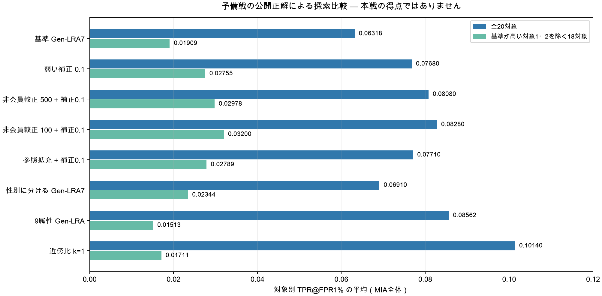

# MIA全体を0.0647へ近づける方法の検討

2026年10月7日、9:00までの検討依頼に対する分析です。

**有望な新手法は、公開AIA課題を既知の非会員として使う地域・性別の順位較正と、係数0.1の弱い他チーム補正の組み合わせです。** 予備戦の公開正解で基準0.06318から0.08080へ改善し、背景の人数・抽出標本を変えた6条件でも、その条件の基準を上回りました。本戦での得点改善は未確認です。

まず [説明.md](説明.md) を読んでください。変更を切り分ける比較として「弱い補正0.1だけ」、参照データを増やす比較として「参照拡充＋補正0.1」も整理しました。

| 予備戦での方式 | MIA全体 | 対象1・2を除く18対象 | 改善／悪化した対象数 |
|---|---:|---:|---:|
| 基準 Gen-LRA7 | 0.06318 | 0.01909 | — |
| 弱い他チーム補正0.1 | 0.07680 | 0.02755 | 4／0 |
| 非会員較正500＋補正0.1 | **0.08080** | **0.02978** | **6／0** |
| 参照拡充＋補正0.1 | 0.07710 | 0.02789 | 6／0 |

上の値は予備戦を再利用した探索結果です。ユーザー共有の本戦第1回0.03434や目標0.0647と、同じ難度の評価ではありません。目標達成を確認した結果として扱わないでください。



資料の入口は次のとおりです。

- [詳しい前提・仮説・分析方法・結論](説明.md)
- [主要候補の比較CSV](共有集計_確認版/主要候補の比較.csv)
- [背景の人数・抽出を変えた感度CSV](共有集計_確認版/固定候補の背景感度.csv)
- [実行記録・コードと入力のSHA-256](共有集計_確認版/実行記録.json)
- [集計の検証コード](検証.py)
- [掲載ファイルとSHA-256](掲載ファイル一覧.json)

## 再現方法

PWS作業ルートの `.venv/bin/python -B` を使います。依存追加はありません。配布データと予備戦の公開正解が配置されたローカル作業ルートで実行してください。掲載コードだけでは公式入力を補いません。

```bash
.venv/bin/python -B 本戦/攻撃フェーズ/Tashiro/MIA全体/experiments/20261007/検証.py --check-inputs
```

`検証.py` は掲載済みCSVの対象別値から平均・改善数を再集計し、コードと入力のハッシュを照合します。攻撃データを持たない環境では `--check-inputs` を省略すると集計・掲載ファイルの整合性だけを確認できます。

再計算する場合は各コードに **新しい** `--output-dir` を指定します。既存結果を上書きしません。

| コード | 調べた内容 | 掲載する結果 |
|---|---|---|
| `分析.py --include-prelim` | 基準の再現、本戦の距離・一致診断 | `結果/` のCSV |
| `追加検討.py` | 密度比、近傍比、補正係数、人数割当て | `追加結果_最終版/` のCSV |
| `対照を揃えた補助検証.py` | 非共有者対対照の補助評価 | `補助結果/` のCSV |
| `参照データの検討.py` | 参照拡充、地域重み、重要度重み | `参照結果_拡張版/` のCSV |
| `ブートストラップの検討.py --include-main` | 背景再標本化と本戦順位の安定性 | `背景再標本化結果/` のCSV |
| `学習による順位補正の検討.py` | 人物・対象を分けた学習評価 | `学習結果_順位校正版/` のCSV |
| `属性部分集合の検討.py` | 数値属性を減らす比較 | `属性部分集合結果/` のCSV |
| `低FPRと対象偏りの検討.py` | 0.5〜5%のFPRと本戦順位変化 | `低FPR結果/` のCSV |
| `固定候補の感度検証.py` | 90%・80%・50%の背景抽出 | `固定候補の感度結果/` のCSV |
| `非会員を使う順位較正の検討.py` | 既知非会員による地域・性別較正 | `非会員較正結果/` のCSV |
| `非会員較正の感度検証.py` | 較正の背景感度・低FPR・本戦順位 | `非会員較正の感度結果/` のCSV |
| `記録と図の作成.py` | 上記結果から比較表・図・実行記録を作成 | `共有集計_確認版/` |

大きい元JSONと途中版の結果はローカルに保存しています。GitHubには最終実行に対応するコード、対象別・集約CSV、実行記録と説明を掲載します。個人別予測、`F_mia.csv`、`F_aia.csv`、提出ZIPは作成していません。CodaBenchへのアクセス・アップロード・提出は行いません。
