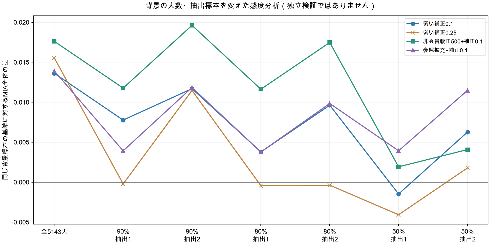

# MIA全体を0.0647へ近づける方法の検討

> **位置付け更新（2026-10-08）：** ここでの『第3回に向けた提案』『現状』『目標との差』は10月7日の分析時点の記録です。10月8日の第3回は既に提出・採点済みで、MIA全体は0.039795でした。方法単独の因果効果や次回の採用を確定した資料ではありません。[最新の判断](../../README.md)／[10月8日の再評価](../20261008/README.md)。

- 最も有望な新手法は、公開AIA課題で分かる非会員を使った地域・性別の順位較正＋弱い他チーム補正0.1
- 較正を弱める設定500を優先候補とします
- 予備戦では基準0.06318から0.08080へ改善し、背景を抽出し直した6条件でも各条件の基準を超過
- ただし、本戦で0.0647に届くことを確認した結果とは別

## 前提

### 目標と現在の公式結果

- 目標は、ユーザーが共有した最高チームの MIA全体の平均0.0647
- 概数の0.06ではなく0.0647を基準にする
- 【ユーザー共有値】

| 本戦の提出済み結果 | MIA全体 | 希少MIA | AUC |
|---|---:|---:|---:|
| 第1回 | 0.03434084 | 0.01493421 | 0.58343429 |
| 第2回 | 0.01090909 | 0.01444567 | 0.61375691 |

- 第2回ではAUCが上がった一方、MIA全体は下がった
- 今回の目的は FPR1%におけるTPRを上げること
- AUCだけでは方式を選ばない
- 採点のMIA成分 `max(全体TPR, 希少TPR)` と、今回の目標である「MIA全体」は区別する
- 【ユーザー共有公式結果・公式コード】
- 公式結果・希少人数の保存元は、既存の `20261006_MIA第2回結果と人数導出/公開用/MIA/20261006_MIA第2回_seo02と希少同点/採点結果/MIA結果.json`
- 最高チームとは攻撃候補B・攻撃対象の組合せが異なるため、0.0647は到達目標として扱い、同じ難度とは断定しない

### 使用データと検証の範囲

| 項目 | 本戦 | 予備戦 |
|---|---:|---:|
| 自チーム | 28 | 5 |
| Bの行数 | 1,049 | 1,049 |
| 今回読み込んだAの行数 | **5,143** | **5,143** |
| 攻撃対象の数 | 22 | 20 |
| 自チームAIA課題とQI7で一致する既知非共有者 | 163 | 163 |
| うち希少 | 13 | 13 |
| 既知非共有者と全希少を除く比較対象 | 875 | 875 |

- 背景の人数は今回の入力CSVを再計数した値
- 予備戦を10,286人とする旧記述を本分析には適用しない
- 交互の行で二分した背景は2,572人・2,571人、層別ランダム抽出の50%は2,573人で、元の5,143人とは別条件である
- 入力の場所とSHA-256は [実行記録](共有集計_確認版/実行記録.json) に残す
- 【配布データ】
- 予備戦では2026年9月9日公開の `pool_ids_*.csv` を採点に使う
- 本戦の所属正解は持たず、使用しない
- 学習の検討だけは予備戦公開正解を学習にも使い、人物と対象チームの双方を分けて評価
- 予備戦を繰り返し使って方式を比較しているため、方式選択の独立検証とは別
- 【公開正解・分析条件】

### 目標との差を人数に換算する

- 第1回から目標への差は `0.0647 − 0.03434084434 = 0.03035915566`
- 各対象の会員を25〜27人とし、改善が対象に分散する場合、22対象で 約17〜18人分の追加検出に相当する
- FPRの枠は各対象おおむね10.2人の誤検出なので、通常者の上位十数人の順序が重要になる
- これは概算であり、本戦の正解人数・対象別TPRを新たに得た値とは別
- 【公式の共有構造・計算】
- 希少については、既存の2回の点数から6対象・計9人と推定済みだが、個人は未特定
- 仮に9人全員を誤検出なしで新たに検出し、通常者の検出を維持できても、平均の上積みは `9/(22×25) = 0.01636` 以下
- 第1回に足した上限は 0.05070で、0.0647に届かない
- 通常者にもおおむね8〜9人分の追加検出が必要になる
- 【保存済み人数推定・条件付き上限】

## 仮説

### 1. 対象への強さと、どの対象にも出る強さを分ける

- 既存Gen-LRA7は、数値5属性 `age/SBP/TG/HDL/ALT` とカテゴリ2属性 `sex/prefecture` を使う
- TG・ALTは対数変換、数値尺度は背景のIQR、混合カーネルで近傍10行の追加効果を評価
- この方法では、背景で珍しい人が複数対象で高順位になり得る
- 対象iの順位 `r_i(x)` から、他対象での順位中央値を少しだけ引く

```text
z_i(x) = r_i(x) − 0.1 × median_{j≠i} r_j(x)
```

- 標的自身は中央値に含めない
- 中央値を丸ごと引く強い補正や、人数を強制する割当ては、本来の会員信号も消す可能性がある
- 補正は共有制約を満たす保証ではなく、順位の仮説として検証
- Gen-LRAの局所的な追加効果という発想は [原論文](https://arxiv.org/html/2508.21146v2) に基づく
- 今回の混合属性実装・他チーム補正・非会員較正の効果は、このプロジェクトでの追加仮説である
- 【既存実装・一次文献・今回の仮説】

### 2. 公開AIA課題を、既知の非会員の標本として使う

- 対象jのAIA課題は、jの非共有ブロックの人と、全コホート・背景の外にいる対照からなる
- したがって i≠jなら、その課題の全行がB_iの非会員と分かる
- member/controlの答えやtimeを読む必要はない
- 今回の自チームBとの突合でも、他対象の課題に未知通常者が一致する例は0だった
- 【公式ルールのデータ構成・配布データ】
- 対象i自身の課題を除き、自チームの課題も含めて集めると、予備戦では6,520行、本戦では7,172行の非会員になる
- QI7での重複は0だった
- この標本を二つの方法で使う
- 順位較正： 背景Aはそのままにして、非会員にもGen-LRAスコアを計算
- 同じ県・性別の非会員で何位に当たるかを較正し、標本の少ない群は全体の順位分布へ寄せる

```text
較正CDF = (群の人数 × 群のCDF + 500 × 全非会員のCDF) / (群の人数 + 500)
```

- 経験CDFの外端・同値には元の順位で小さい差を付ける
- その後875人の順位へ直し、仮説1の補正0.1を加える
- 県・性別だけで非会員と決めたり、自地域を一律0にしたりはしない
- 参照拡充： 非会員をGen-LRAの参照密度に追加する
- 予備戦の参照は5,143＋6,520＝11,663行、本戦は5,143＋7,172＝12,315行
- ただしAIA課題は地域・希少者の比率が背景と違うため、単純追加と各種の重み付けを比較
- 参照追加と順位較正は別の変更であり、効果を加算して予測しない
- 密度比を使うMIAの背景には [DOMIAS原論文](https://proceedings.mlr.press/v206/breugel23a.html) がある
- 今回の参照選定と地域・性別の較正は、PWSの公開データ構造からの推論である
- 【一次文献・今回の仮説】

### 3. 距離・属性・近傍数の変更が低FPRに効くか

- 本戦背景では、HDLのIQR尺度が全体8.7917に対しsex=0で0.6663だった
- 全体尺度ではsex=0内のHDL差を弱く扱うため、性別分割・相関補正・属性を減らす方法を検討した
- これは改善を保証する根拠とは別
- 【配布データ・仮説】
- 点の密度比、近傍距離比、背景の再標本化、学習による順位補正も比較し、「AUCや平均が上がるだけでなく、低FPRと複数対象で改善するか」を確認

## 分析方法

### 採点条件を揃える

- 通常者875人の順位だけを変更
- 全方式で既知非共有者163人を0、未知希少11人を同点0.4、通常者を0.6より上に置く
- このため希少MIAの新しい回答を作る分析とは別
- 基準の予備戦MIA全体は、既存 `A_mixed7_9` の対象別TPRを最大誤差0で再現した
- 希少の順位を共通条件にしたため、過去提出の希少TPR・AUC全体をそのまま再現したとは扱わない
- 同値は一つのROC点にまとめ、FPR1%で線形補間する
- scikit-learnによるROCと、配布された公式 `_tpr_at_fpr` を低FPRの全比較で照合し、最大差0を確認済み
- 入力ファイルは実行前後のSHA-256で不変を確認済み
- 【公式コード・再集計】

### 主な結果

- 以下は すべて予備戦の公開正解による探索結果
- 対象1・2を外した18対象の欄は、基準で特に高い2対象への偏りを見る感度分析であり、公式集計の置換とは別

| 方式 | 全20対象 | 他18対象 | 改善／悪化 | 判断 |
|---|---:|---:|---:|---|
| 基準Gen-LRA7 | 0.06318 | 0.01909 | — | 比較基準 |
| 弱い補正0.1 | 0.07680 | 0.02755 | 4／0 | 変更を切り分ける候補 |
| 弱い補正0.25 | 0.07873 | 0.02970 | 6／0 | 背景抽出とFPR0.5%で不安定 |
| 非会員較正500＋補正0.1 | **0.08080** | **0.02978** | **6／0** | 優先する新手法 |
| 非会員較正100＋補正0.1 | 0.08280 | 0.03200 | 7／0 | 500より強い較正／探索候補 |
| 参照拡充＋補正0.1 | 0.07710 | 0.02789 | 6／0 | 別の比較候補 |
| 性別Gen-LRA7 | 0.06910 | 0.02344 | 6／4 | 改善と悪化が混在 |
| 9属性Gen-LRA | 0.08562 | 0.01513 | 5／4 | 2対象への偏りが大きい |
| 近傍比k=1 | 0.10140 | 0.01711 | 7／5 | 平均だけでは採用しない |
| 近傍比k=10 | 0.01377 | 0.01531 | 3／6 | AUC上昇がTPR改善に結び付かない |
| 学習による2特徴補正 | 0.04973 | 0.01694 | 2／3 | 今回の設定では悪化 |
| 学習による5特徴補正 | 0.03809 | 0.00676 | 2／6 | 今回の設定では悪化 |

- 正確な値と元表は [主要候補の比較CSV](共有集計_確認版/主要候補の比較.csv) に置く
- 背景を地域・性別や年齢に合わせた重み付け、非共有者を混ぜた参照、人数を25人ずつ強制する割当て、属性部分集合、背景再標本化は、上の優先候補を一貫して上回らなかった
- 人数の強制割当ては全20対象0.04548へ悪化した

### 背景とFPRを変えた感度

- 性別×県の層内で背景を90%・80%・50%抽出し、それぞれseed 20261007・20261008で再計算した
- 較正500＋補正0.1は、6条件すべてでその背景の基準を上回った
- 較正100も6条件で上回ったが、90%抽出の一つでは弱い補正だけに劣った
- 係数0.25は90%・80%の4条件中3条件で基準を下回った
- 【公開正解による感度分析】



| FPR | 基準 | 補正0.1 | 較正500＋補正0.1 | 較正100＋補正0.1 |
|---|---:|---:|---:|---:|
| 0.5% | 0.05932 | 0.06318 | **0.06702** | 0.06125 |
| **1%（採点対象）** | **0.06318** | **0.07680** | **0.08080** | **0.08280** |
| 2% | 0.08295 | 0.09065 | 0.09265 | 0.08880 |
| 5% | 0.14219 | 0.13861 | 0.13643 | 0.14435 |

- 500を優先する理由は、採点点での僅かな最大値より、弱い較正と低FPRでの安定性を重視するため
- FPR5%まで一様に改善する方式とは言えない
- 50%や交互行の二分では効果が変わり、背景の少なさも限界になる

### 補助評価・本戦で確認できること

- 地域・性別を揃えたAIAの非共有者150人対対照150人では、基準TPR平均0.02233、補正0.1が0.02400、補正0.25が0.02167だった
- 補正0.1でも5対象改善・5対象悪化で、他18対象の平均は僅かに下がった
- これは非共有者の識別という別の課題で、共有者を当てるMIA全体の確認とは別
- 学習の比較は5分割の人物と4分割の対象を組み合わせた二方向の交差検証を行った
- テスト対象のラベルは学習に使わず、モデルにID・対象番号・患者の生属性は渡さない
- 学習器間の尺度を公開候補の順位で揃え、1特徴の単調変換で基準を再現する対照も確認済み
- この条件で2・5特徴の補正は低FPRを悪化させた
- 本戦では較正500＋補正0.1により、基準の上位12候補から各対象平均4.64人が入れ替わった
- 一方、3対象以上で上位12に入る人は基準8人から13人になった
- したがって、他チーム補正が複数対象での高順位を必ず解消するという仮説は支持されない
- 本戦の正解がないため、入替えが改善か悪化かは判定できない
- 【配布データによる順位診断】
- 本戦22対象には、6検査値のうち同じ行で2属性以上が1e-8以内に一致するB候補がなかった
- timeの一致は背景にもあり、今回の単純な一致攻撃を優先する根拠は得られなかった
- 背景の再標本化でも上位12が動くため、上位候補の安定性だけで正解とは扱わない

## 結論

- 新手法の優先候補は「Gen-LRA7＋既知非会員による県・性別の較正500＋他チーム補正0.1」
- 予備戦の低FPR、複数対象、背景抽出で改善が残り、単に9属性や近傍比の大きな平均を選ぶより根拠がある
- ただし、予備戦で比較した複数設定からの選択であり、本戦への転移は未確認
- 実際に採用・作成する指示を受けた後の比較は、次の順序を提案する

| 比較 | 今回変えること | 比較対象 | 結果から判断できること |
|---|---|---|---|
| 変更の切り分け | 第1回の通常者Gen-LRA7順位に補正0.1だけを加える | 第1回MIA全体0.03434 | 弱い他チーム補正が本戦でも効くか |
| 新手法 | 同じ補正0.1に、非会員による県・性別較正500を加える | 上の比較 | 非会員の条件付き順位が追加効果を持つか |
| 別の参照仮説 | 補正0.1のまま、較正に代えて非会員を参照密度へ追加する | 補正だけ・較正との比較 | 参照密度の不足と条件付き順位のどちらが効くか |

- これはMIA通常者部分の比較軸である
- 実際の各回には既存の希少人数識別とAIAの改良・新手法の目的も組み合わせ、早い回を過去最良回答の単純統合や既知非会員の0化だけに置き換えない
- AIAを固定してMIAだけの効果を切り分ける提出案は提案しない
- 第8回の統合方針は別途維持
- 目標へ必要な約17〜18人分の上積みを、今回の予備戦で見えた改善人数から本戦へそのまま予測してはいけない
- 希少9人の理想的な追加効果との加算も保証できない
- 本戦のMIA全体の新しい公式結果が出るまでは、「有望な方法を見つけた」という結論にとどめる
- 今回の依頼で作成したのは分析コード・集計・説明
- CodaBenchにはアクセス・アップロード・提出しない
- `F_mia.csv`・`F_aia.csv`・提出ZIPを作成せず、分析資料をGitHubの `攻撃フェーズ/Tashiro/20261007_MIA全体改善の検討/` に掲載する
